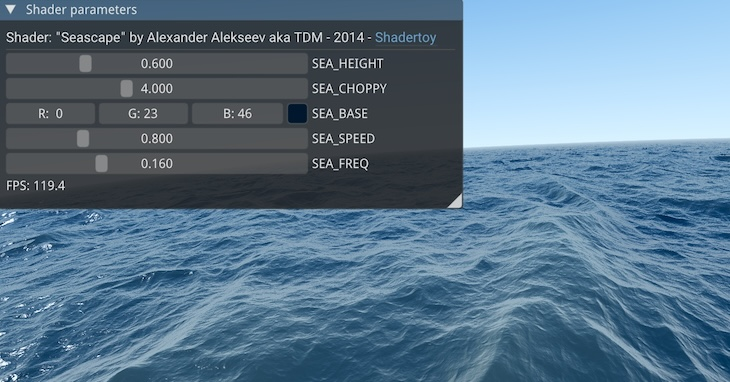

*Version scheme: ImGui Bundle uses `major.minor.patch` where `patch = ImGui_patch × 100 + bundle_release`. For example, ImGui v1.92.6 → Bundle v1.92.600, and a bugfix becomes v1.92.601.*

# Next release - WIP

## Breaking changes

- Python 3.10 is no longer supported: `imgui-bundle` needs Python 3.11 or later, like its wheels (3.11 to 3.15). Python 3.10 reaches its end of life in October 2026.

# v1.93.0

This is a big release, with 911 commits since v1.92.900: Dear ImGui 1.93, a Markdown library of its own, the node editor on its upstream version, and a renewed Bundle Explorer and playground.

Pictures and videos of the novelties: [the release page](https://imgui-bundle.pages.dev/releases/1.93/).

## Highlights

1. **Dear ImGui 1.93.0**, with its reworked draw list: crisper shapes. See [Dear ImGui 1.93.0](#dear-imgui-1930).
2. **A renewed Bundle Explorer and playground**: a welcome screen, a gallery of the demos, phones and tablets, light and dark. See [The Bundle Explorer and the playground](#the-bundle-explorer-and-the-playground).
3. **An API reference, with live demos**: the book's API pages in Python and C++, and an API tab in the ImGui Explorer. See [The API reference](#the-api-reference).
4. **RichMd**: the markdown renderer becomes a standalone library, with documents, selectable text, Mermaid diagrams and narrative programming. See [RichMd, the markdown renderer](#richmd-the-markdown-renderer).
5. **The node editor on thedmd's v0.9.4**, with widgets that work inside nodes. See [The node editor](#the-node-editor).
6. **Phones and tablets**: Hello ImGui turns a finger into the gestures its user expects. See [Hello ImGui](#hello-imgui).
7. **Wheels for Python 3.15**. See [Python](#python).

Also new: Stack Layout v2.2 by thedmd ([Stack Layout v2.2](#stack-layout-v22)), and a guide for AI assistants ([For AI assistants](#for-ai-assistants)).

Ctrl+Tab switches windows on the Mac too ([GLFW 3.5.1](#glfw-351)).

## Breaking changes

### Python and C++:

- The draw list (see [Dear ImGui 1.93.0](#dear-imgui-1930)):
  - `ImDrawFlags_.round_corners_xxx` become `ImDrawFlags_.round_xxx`
  - `ImDrawListFlags_` is merged into `ImDrawFlags_`
  - `style.curve_tessellation_tol` becomes `style.curve_tessellation_max_error`
  - `style.anti_aliased_lines_use_tex` is removed
  - `ImFont.add_remap_char()` becomes `add_remap_codepoint()`
- `TextFilter`: `draw()` lost its width, `TextRange` and `count_grep` are removed, `draw_with_hint()` is new.
- Stack Layout: a negative size is relative to the far edge, and a layout scopes the IDs of its items (see [Stack Layout v2.2](#stack-layout-v22)).
- The mouse wheel: in a window that scrolled, a custom widget that reads `io.mouse_wheel` no longer sees the wheel, until it claims it with `set_item_key_owner(Key.mouse_wheel_y)` (see [Hello ImGui](#hello-imgui)).
- The internal API (`imgui.internal`, `imgui_internal.h`):
  - `set/get_font_rasterizer_density()` become `set/get_pixel_density()`
  - `im_round64()` becomes `im_round_positive64()` or `im_round_signed64()`
  - the context hooks `begin_window` / `end_window` are removed: the node editor uses two window callbacks instead

### Python:

- The C++ "text end" parameters leave the API (see [Python](#python)).
- `imgui.set_drag_drop_payload(type, data, sz)` is removed: use `imgui.set_drag_drop_payload_py_id()`.
- `slider_float2/4`, `input_float2/4`, `color_edit3/4` and `color_picker3/4` return an `ImVec2` / `ImVec4` when given one, instead of a `list`.
- Some errors raise `ValueError` or `IndexError`, instead of a `RuntimeError`.
- Some demos moved: `python -m imgui_bundle.demos_python.demos_immapp.demo_run_async` and its likes change their path (see [the demos](#the-bundle-explorer-and-the-playground)).

### C++:

- `ed::Config::SettingsFile` is a `const char*` again, and the `std::vector` versions of `GetSelectedNodes()` and its likes left the fork (see [The node editor](#the-node-editor)).
- RichMd: the renderer class `imgui_md` is internal: the compatibility header no longer names it (see [RichMd](#richmd-the-markdown-renderer)).
- ImmVision never links OpenCV (see [ImmVision](#immvision)).
- The CMake package is named `imgui_bundle`, instead of `imgui-bundle` (see [C++](#c)).

## Libraries

### Dear ImGui 1.93.0

Dear ImGui is updated to [v1.93.0](https://github.com/ocornut/imgui/releases/tag/v1.93.0), and ImGui Test Engine to its latest version.

- The draw list is reworked: Dear ImGui's widgets look the same or crisper.
- Custom drawing can move by half a pixel. [ocornut/imgui#9504](https://github.com/ocornut/imgui/issues/9504) explains how to migrate.
- `StyleColorsDark()` is refreshed: a greyer window background, without transparency.
- A drag or a slider edit can be cancelled with a right click or Escape.
- On a touch screen, sliders and drags show their value in a tooltip above the finger (a patch of the bundle, proposed upstream as [ocornut/imgui#9575](https://github.com/ocornut/imgui/pull/9575)).


*Picture: Dear ImGui 1.93.0's [release notes](https://github.com/ocornut/imgui/releases/tag/v1.93.0).*

<details>
<summary>The draw list: the details</summary>

Custom drawing can move by half a pixel:

- `add_line()` lost its half pixel offset.
- Closed shapes (rectangles, circles...) are stroked inside by default.

On high density screens (Retina), anti-aliasing and the tessellation of curves follow the framebuffer scale.

New:

- `add_line_h()` and `add_line_v()`, for straight lines
- stroke flags: `stroke_inside`, `stroke_center`, `stroke_outside`, `stroke_legacy`, `join_miter`, `cap_square`...
- `push_draw_flag()` / `pop_draw_flag()`, for a scope
- `io.config_debug_draw_list_defaults_to_stroke_legacy`: draws everything as before, to compare

Breaking:

- `ImDrawFlags_.round_corners_xxx` become `ImDrawFlags_.round_xxx`.
- `ImDrawListFlags_` is merged into `ImDrawFlags_` (`aa_lines`, `aa_fill`, `use_vtx_offset`).
- `TextFilter.draw()` lost its width: call `imgui.set_next_item_width()` before it.
- `style.anti_aliased_lines_use_tex` is removed.
- `ImFont.add_remap_char()` becomes `add_remap_codepoint()`.
- In C++, the old names stay unless `IMGUI_DISABLE_OBSOLETE_FUNCTIONS` is defined.

`style.curve_tessellation_tol` becomes `style.curve_tessellation_max_error`. The new field is in pixels (the old one was in squared pixels): `curve_tessellation_max_error = sqrt(curve_tessellation_tol)`.

```python
imgui.get_style().curve_tessellation_max_error = 1.12   # was: curve_tessellation_tol = 1.25
```

</details>

<details>
<summary>Other changes</summary>

- `imgui.ItemFlags_.mixed_value` shows a mixed value in checkboxes, radio buttons, drags, sliders, inputs, color widgets and combos. See "Widgets / Mixed Values" in the demo.
- Disabled color buttons keep their color.
- Test Engine: `TestContext.item_drag_to_pos()`, `TestContext.item_make_visible()`, `TestOpFlags_.no_wait_when_moving`. Actions on a moving item wait for it to settle.

</details>

### Stack Layout v2.2

`begin_horizontal()`, `begin_vertical()` and `spring()` follow thedmd's [v2.2](https://github.com/ocornut/imgui/pull/846#issuecomment-6232934755). It includes the fixes ImGui Bundle carried.

- A negative size is relative to the far edge, as for other widgets. It meant "automatic".
- A layout scopes the IDs of its items, like `push_id()`. Settings saved under them (e.g. in imgui.ini) reset once.
- A layout clips its content only on the axes given a fixed size.
- Widgets that call `same_line()` (`drag_float3()`, `input_int()`...) no longer collapse in a horizontal layout.

<details>
<summary>Stack Layout: the details</summary>

- In a horizontal layout, items flow as in a menu bar: `separator()` is vertical, and `new_line()` starts a new row.
- `ListClipper` works in a vertical layout, tables in a horizontal one.
- Decorations at the edge of a layout (the focus rectangle, a selection highlight) are no longer cut.
- New: `imgui.set_next_layout_debug_flags()` draws the springs or the items of the next layout. See "Layout & Scrolling / Stack Layout" in the demo.
- `imgui.StyleVar_.layout_align` moves to the end of the enum: the style vars after it have their stock Dear ImGui values again.
- The book's page on Dear ImGui has a new section on these layouts: when to prefer them to `same_line()`, their sizes, their IDs.

```python
imgui.begin_horizontal("row", hello_imgui.em_to_vec2(12, 0))  # fixed width: 12 em
imgui.text("A long text which does not fit in 12 em")         # now cut at 12 em
imgui.end_horizontal()
```

</details>

### RichMd, the markdown renderer

The markdown renderer is now [imgui_rich_md](https://github.com/pthom/imgui_rich_md), a standalone library that works with a stock Dear ImGui.

- Documents: `rich_md.document()` shows a long text with a table of contents, a search (Ctrl+F or "/"), anchor links and foldable headings.
- Selectable text: select with the mouse, copy with Ctrl+C / Cmd+C, a menu on right click.
- Mermaid diagrams (flowcharts, sequence and class diagrams), drawn natively.
- Widgets in the text: `register_fenced_block_renderer("lang", fn)` draws a fenced block of that language.
- Narrative programming: a source file carries its own narrative, which `rich_md.render_this_file("Name")` renders.

Python code keeps working: `imgui_bundle.imgui_md` stays, as an alias of `imgui_bundle.rich_md`.

<details>
<summary>RichMd: the details</summary>

Names:

- Python: the module is `imgui_bundle.rich_md`. `imgui_bundle.imgui_md` is the same module.
- C++: the API is `RichMd::` in `imgui_rich_md/rich_md.h`. The former include `imgui_md_wrapper/imgui_md_wrapper.h` and the namespaces `ImGuiMd` and `ImGuiMicroTeX` stay as aliases.
- C++, breaking: code that used the renderer class `imgui_md` (md4c's client) breaks: that class is internal now.
- CMake: `IMGUI_BUNDLE_WITH_IMGUI_MD` becomes `IMGUI_BUNDLE_WITH_IMGUI_RICH_MD`. The former name still works, with a warning.

Rendering:

- Behavior change: `rich_md.render()` removes the common indentation of the text, and resolves its transclusions. `render_raw()` renders the text as is. `render_unindented()` stays, as the former name.
- `rich_md.render_folding()`: a text folded to its first paragraph, or to `<!--more-->`.
- `render_file()`, and `render_mermaid()` for a diagram alone.
- Anchor links (`[text](#slug)`) scroll to their heading. Wikilinks (`on_wiki_link`), `<center>` blocks, `<br/>`, hidden HTML comments.
- A size pushed with `imgui.push_font(None, size)` scales the markdown.
- Inline formulas wrap like words. An invalid LaTeX formula shows its source in the error color, instead of ending the app.
- Code blocks: `markdown` is highlighted as markdown, an unknown language as plain text. A wrap button shows when a line overflows. They follow the indent of quotes and lists, and scroll when long.
- A gap between paragraphs.

Selectable text:

- A double click selects a word, a triple click a paragraph.
- The menu: Copy, Copy as Markdown, Select All, Copy Link.
- Links open on release. On a phone, a tap on a link opens it in a new tab.
- `MarkdownOptions.selectable_text`, `push_selectable_text()` / `pop_selectable_text()` and `set_selectable_text_default()` turn it off.

Documents:

- `rich_md.document()`, or `begin_document()` / `render_document()`.
- With `hello_imgui.prefers_reduced_motion()`, a document scrolls without animation.

Narrative programming:

- `::md Name` sections in comments or strings, and transclusions (`![[file#Name]]`).
- `rich_md.render_this_file("Name")` (C++: `RICHMD_RENDER_THIS_FILE`) renders a section of the calling file, and follows the file when it changes.
- The book has a section on it.

Python:

- `rich_md.set_download_function()`: `MarkdownCallbacks.on_download_data` is deprecated.
- Contexts: `create_context()`, `destroy_context()`, `set_current_context()`, `get_current_context()`.
- ImmApp restores the markdown context that was current before `run()`, instead of destroying it.

</details>

### The node editor

The node editor follows thedmd's `master` (v0.9.4: about 110 fixes, and a test suite), instead of the old `develop` branch.

- Popups, combos, color pickers, tooltips and context menus work inside the editor without `suspend()` / `resume()`, also between nodes.
- Every editor follows the theme, light or dark.
- Zoomed out, links and node borders stay crisp with Dear ImGui 1.93.
- The fork contains nothing specific to ImGui Bundle anymore, and has its own [documentation](https://github.com/pthom/imgui-node-editor/blob/imgui_bundle/docs/fork_imgui_bundle.md). It builds with a stock Dear ImGui; its popups need two small Dear ImGui patches, which the bundle carries.

<details>
<summary>The node editor: what changes for an application</summary>

- `get_action_context_nodes()` and `get_action_context_links()` return what a shortcut acts on, between `begin_shortcut()` and `end_shortcut()`. For the selection, use `get_selected_nodes()` and `get_selected_links()`.
- `end_create()` may be called after every `begin_create()`, or only when it returned true.
- A right drag that starts on a widget of a node pans the view.
- Smooth zoom stays on by default.
- `Style.angled_links` (default: `True`) turns off the routing of links around their nodes, which the bundle's fork already did.
- Colors pushed with `ed.push_style_color()` before `ed.begin()` are now overwritten: push them after it.
- `Config.settings_file` is an `Optional[str]`: `None` means "no settings file".
- `get_selected_nodes()`, `get_selected_links()` and their likes are no longer limited to 1000 elements.
- New `ed.get_mouse_pos_on_canvas()`: the mouse in canvas coordinates, also where the editor is suspended (e.g. to place a node at the end of a new link).
- Python: `NodeId`, `LinkId` and `PinId` are false when null (`if ed.get_hovered_node():` was always true). Each function has a docstring.
- With `Config.force_window_content_width_to_node_width`, a node that collapses to one character is reported, with the fix.
- Markdown code blocks inside a node are rendered as inline code. Without ImmApp, set `imgui_md.MarkdownCallbacks.can_use_child_windows` yourself.
- C++: new `ed::InputTextMultiline()`, `ImGuiEx::IsInsideCanvas()`, and `ed::SetBeginHook()` (called at each editor's `Begin()`).

**Breaking changes (C++)**

`ed::Config::SettingsFile` is a `const char*` again, as upstream. The editor keeps the pointer: keep your string alive. Python is not concerned.

```cpp
static std::string settingsFile = MySettingsFolder() + "/nodes.json";   // must outlive the editor
config.SettingsFile = settingsFile.c_str();                             // was: config.SettingsFile = settingsFile;
```

- The `std::vector` versions of `GetSelectedNodes()`, `GetSelectedLinks()`, `GetActionContextNodes()`, `GetActionContextLinks()` and `GetOrderedNodeIds()` left the fork: use upstream's versions, with an array.
- The hidden functions `Priv_ImGuiNodeEditor_EnterCanvas() / ExitCanvas() / IsInCanvas()` were removed from Dear ImGui: use `ImGuiEx::IsInsideCanvas()`.

</details>

### Hello ImGui

On a touch screen, Hello ImGui turns a finger into what its user expects, with nothing to write in the app:

- a swipe scrolls, with inertia
- a tap clicks, a long press is a right click
- two fingers pinch to scale, or drag together to pan
- a text field opens the phone's keyboard

Also:

- **Idling without frozen animations**: `hello_imgui.set_item_is_live()` and `request_refresh()` keep the full frame rate while content changes by itself. The idle rate is now exactly `fps_idle`.
- **Readable themes**: the 17 themes were reviewed. Text cursors, slider grabs, selections, disabled text, borders and tabs read well in each of them.
- **The mouse wheel**: a wheel that started on a page keeps scrolling it when the mouse passes over a plot or an image.

<details>
<summary>Touch screens: the details</summary>

- A swipe scrolls the content of a window, with a bounce at the end, even when it starts on a button or a text.
- Two taps are a double click.
- A short hold, then a drag, goes to the widget under the finger (a slider, a text selection). A ring shows when the hold took effect.
- A finger still for half a second, then lifted, is a right click.
- The scroll bars are thin indicators. A hold on a bar hands its thumb over, as on iOS.
- Two fingers that move together are a right drag (the pan of a node editor, the box selection of a plot).
- The keyboard: an active text widget shows a keyboard button. The keyboard serves any widget that wants text (the code editor too), stays open when a tap moves the caret, and comes back after iPadOS or Android hid it.
- `hello_imgui.set_item_takes_touch_drags()`: a plot, a canvas or a node editor takes a finger's drag at once, without the hold.
- `hello_imgui.set_tap_opens_url()`: in a browser, a tap opens a URL in a new tab.
- ImPlot's drag tools get finger-sized grabs, ImmVision pans an image at once, the command palette fits a phone.
- The settings: `RunnerParams.touch_scroll_mode`, `touch_long_press_is_right_click`, `touch_pinch_mode`, `touch_pinch_interrupts_widgets`, `touch_thin_scrollbars`.
- The demo "Touch screens (phones, tablets)" shows every gesture. On a desktop, its "Simulate a touch source" checkbox plays the finger with the mouse.

</details>

<details>
<summary>Idling, themes, the mouse wheel: the details</summary>

- Idling: in a browser, `fps_idle = 30` gave 20 or 30 frames per second; it gives 30. The book's page on Hello ImGui has a section on idling.
- Themes: they start from Dear ImGui's dark or light colors. The light themes drew the text cursor white on white. A held slider's grab stands out. SoDark and BlackIsBlack dim the background of modals neutrally.
- The mouse wheel: a wheel that starts on the item is the item's. `RunnerParams.wheel_session` (default: `True`) turns the behavior off.
- The mouse wheel, behavior change: a custom widget that reads `io.mouse_wheel` claims it with `imgui.set_item_key_owner(imgui.Key.mouse_wheel_y)`, as ImPlot and ImmVision do. Without the claim, in a page that scrolls, it never sees the wheel.

</details>

<details>
<summary>New functions, the web, SDL, Vulkan</summary>

- `hello_imgui.save_lasting_pref()` / `load_lasting_pref()`: preferences kept outside the ini file, so that a reset of the layout keeps them (in the browser's local storage on the web).
- `hello_imgui.prefers_reduced_motion()`: the system's "reduce motion" setting, on macOS, iOS, Windows and the browser.
- `hello_imgui.load_image_data_from_encoded_data()`: decodes an image file's bytes, without OpenCV.
- The web:
  - In a browser on a Mac, Cmd acts as Ctrl in every widget (Cmd+C copies).
  - The canvas follows Safari's page zoom.
  - A demo opened in a popup window takes the app's window size.
  - The page's icon is the app's icon.
- SDL (C++): the DPI scale comes from the display that holds the window, instead of the first display.
- Vulkan:
  - a texture is destroyed only once the device is idle (an app could end with `VK_ERROR_DEVICE_LOST`)
  - `fps_idling.vsync_to_monitor` and screenshots are implemented
  - Vulkan errors raise an exception with the name of the `VkResult`, instead of calling `abort()`
  - new CMake option `HELLOIMGUI_VULKAN_VALIDATION`

</details>

### GLFW 3.5.1

The desktop Python wheels use GLFW 3.5.1 (was 3.4). C++ builds without a system GLFW download it too (was 3.3.8).

- On the Mac, Ctrl+Tab now reaches the app: Dear ImGui's window switcher works there too. Hold Ctrl and press Tab to go through the windows (Shift+Tab goes back), then release Ctrl to focus one. It already worked on Windows and Linux.
- Also: fixes for X11 and Wayland, and Windows XP and Vista are no longer supported. See [GLFW's changelog](https://github.com/glfw/glfw/releases/tag/3.5.1).

<!--  -->

### ImmVision

- RGB is the default color order: `immvision.use_rgb_color_order()` is no longer needed. BGR images (OpenCV) still need `immvision.use_bgr_color_order()`.
- A negative display size is the remaining space, as ImGui's item widths: `(-1, 0)` takes the window's width, and the height from the aspect ratio.
- `ImageParams.image_to_screen()` and `image_screen_top_left`: draw over a displayed image.
- On a phone: a finger pans an image at once, and the inspector fits the screen.

<details>
<summary>Breaking change (C++): ImmVision never links OpenCV</summary>

- The `cv::Mat` conversions are header-only.
- An application that passes `cv::Mat` defines `IMMVISION_HAS_OPENCV`, and links OpenCV itself.
- `IMMVISION_FETCH_OPENCV` only provides a minimal OpenCV to `find_package(OpenCV)`. On Windows, it builds OpenCV from source: the precompiled `opencv_world` pack is removed.

```cmake
find_package(OpenCV REQUIRED)
target_compile_definitions(my_app PRIVATE IMMVISION_HAS_OPENCV)
target_link_libraries(my_app PRIVATE opencv_core)
```

</details>

### Other libraries

- **ImGuiColorTextEdit**, updated to upstream's `master`: East Asian wide glyphs, custom line numbers, whole word search, squiggles.
- **ImAnim**, updated to upstream's `main`: grid stagger, delays, loop and pause callbacks, two tween policies.
- **ImPlot and ImPlot3D in ImmApp** follow the DPI factor: on a screen at 150% or 200% (Windows, Linux), a plot of the default size scales like the widgets around it ([#501](https://github.com/pthom/imgui_bundle/issues/501)). The line weights and marker sizes of the plotted items stay in pixels.
- **immapp**: `immapp.start_download()` starts an HTTP request in the background, and `immapp.decode_image()` decodes an image file's bytes without OpenCV.
- **imgui_toggle** reads like a checkbox in every theme. **ImGuizmo**, **imspinner** and **ImPlot3D** are updated.

<details>
<summary>Other libraries: the details</summary>

ImGuiColorTextEdit:

- East Asian wide glyphs take two grid cells.
- New: `set_custom_line_number_renderer()`, `set_text()` from a list of lines, `find_word_start()` / `find_word_end()`, `is_mouse_pos_over_text_area()`, `doc_pos2_screen_pos()`.
- Squiggles: `add_squiggle(..., style=SquiggleStyle.background)`.
- `set_find_replace_enabled()`, `set_show_current_line_highlight_enabled()`.
- A `whole_word` option on `add_next_occurrence()` / `select_all_occurrences()`. `scroll_to_line()` centers the line by default.
- Smooth scrolling, off by default: `set_smooth_scrolling_enabled()` / `is_smooth_scrolling_enabled()`. `scroll_to_line()` then glides to its line.
- `clear_change_callback()` / `clear_transaction_callback()` deactivate a callback.
- Fixes: a focused editor captures the keyboard again, the IME window sits at the cursor, a read-only editor no longer opens a phone's keyboard, the fold chevrons are whole without line numbers. Upstream: a crash on empty text, the double click word selection, the autocomplete window, more editing shortcuts.

ImAnim:

- grid stagger: `stagger_grid_opts`, `stagger_grid_delay()`
- `play_with_delay()`, `clip.set_stagger_ease()`, `clip.set_loop_delay()`
- the callbacks `clip.on_loop()` and `clip.on_pause()`
- `instance.restart()` / `reset()` / `refresh()`
- the tween policies `policy.additive` and `policy.multiply`

immapp:

- `immapp.start_download(url, method, json_body, timeout_s, headers)`: a thread on the desktop, a fetch in the browser. The GUI looks at the result's `done` at each frame, then at its `status`, `data` and `error`. See the book's page on async Python.
- `immapp.download_url_bytes()` and `download_url_bytes_async()` gain `timeout_s`.
- `immapp.decode_image(bytes, channels=3)`, also in Pyodide.
- `with_im_anim` works in `manual_render` (Pyodide) and in `immapp.testing.run()`.
- `immapp.testing.run()` needs no `gui_function` when given `runner_params`. `capture_final_frame()` takes `add_ons_params`.

The others:

- imgui_toggle: without a palette, "on" takes the theme's check mark color, and the toggle draws the style's frame border (merged upstream).
- ImGuizmo: upstream fixes (`SetRect`'s maximum y, the tripod of multiple views). imspinner: updated.
- ImPlot3D: its lines render right with Dear ImGui 1.93, without blur on Retina.
- imgui-command-palette: usable on a phone, its list above the keyboard.
- imgui_explorer: `set_imgui_explorer_libraries()` picks the libraries an app shows.

</details>

## Python

- Wheels for Python 3.15, on the same platforms as the other versions ([#502](https://github.com/pthom/imgui_bundle/issues/502)). The wheels now cover Python 3.11 to 3.15.
- `imgui.begin_simple(name, flags)`: `begin()` for a window without a close button, which returns a bool. `begin()` returns two values, so `if imgui.begin(...):` was always true.
- ImmVision, and ImPlot's `plot_heatmap()` and `add_colormap()`, accept read-only numpy arrays, such as `np.asarray()` of a Pillow image or `np.frombuffer()`. They raised "incompatible function arguments".
- `slider_float2/4`, `input_float2/4`, `color_edit3/4` and `color_picker3/4` return an `ImVec2` / `ImVec4` when given one, as the stubs said.
- The C++ "text end" parameters leave the API: a Python string passed there made C++ read from an unrelated address ([#498](https://github.com/pthom/imgui_bundle/discussions/498)).

<details>
<summary>Python: the details</summary>

```python
color = imgui.ImVec4(1, 0, 0, 1)
changed, color = imgui.color_edit4("color", color)   # color is still an ImVec4 (was a list)
```

Lists and tuples still return a `list`.

The "text end" parameters removed:

- `text_end` in `imgui.text_unformatted()`, `imgui.calc_text_size()`, `ImDrawList.add_text()`, `ImFont.render_text()`, `ImFontGlyphRangesBuilder.add_text()`, `InputTextCallbackData.insert_chars()`, `TextFilter.pass_filter()`, `TextBuffer.append()`, the test engine's `TestContext.item_info_handle_wildcard_search()`, and the internal API
- the two-string overloads of `push_id()` and `get_id()`
- `imgui.internal.separator_text_ex()`: it shows the label up to its `##`, as `separator_text()` does

A call that passed `None` as the end must drop it.

Arrays: empty and one-element arrays pass the buffer check, whatever their stride (about 60 functions, mostly ImPlot's). A fix of litgen, by Clay Dugo.

The stubs:

- a docstring for each module (what it is for, then the notes for Python users)
- the original C++ signatures in eleven more stubs
- their comments name the Python API (`imgui.push_id()`, `RunnerParams.callbacks.show_menus`), instead of the C++ one
- `imgui.begin()`, `menu_item()` and `begin_tab_item()` document their results, and point to their `_simple` versions

The extras: `[full]` no longer installs PyGLM (the ImGuizmo demo does without it), and `[pyglet]` needs pyglet 2.0.10 or later.

Source builds work with nanobind 3.

The Pyodide wheel stays on Python 3.14.

</details>

## Web: the explorers, the playground and the docs

### The Bundle Explorer and the playground

The [Bundle Explorer](https://imgui-bundle.pages.dev/explorer/) and the [playground](https://imgui-bundle.pages.dev/playground/) were reviewed from end to end, and look much nicer:

- **One welcome screen** for both: a carousel of eleven live slides (plots, a GPU shader, the Lorenz attractor, a neural network, images, a node editor, markdown...), then a button to the demos.
- **A gallery of the demos**, by category, with their pictures, a search box and a library filter. Each demo shows its code, and runs in place.
- **Phones and tablets**: one pane at a time (Demo or Code), and every demo checked on a phone.
- **Light and dark**: a theme switch in the header.
- **New demos**: a tiny neural network that learns two spirals, a WebAudio synthesizer, "Plotting with Python" (Matplotlib, Seaborn, Cartopy), and interactive manuals of Dear ImGui, ImPlot, ImPlot3D and ImAnim.

<details>
<summary>The Bundle Explorer and the playground: the details</summary>

- The same gallery in the Python and C++ explorers, and in the playground. It replaces the explorer's former tabs (Dear ImGui, Demo Apps, Visualization, Widgets, Tools).
- The browser's back and forward buttons move in the web explorer, and a link can open a demo.
- The explorers remember the choice of C++ or Python.
- The playground:
  - besides light and dark, a "..." menu with Hello ImGui's 17 themes, and A- / A+ buttons for the font size
  - the desktop-only demos are listed too, with a "Desktop only" tag: a click shows their code, their picture, and how to run them
  - the error window shows the whole traceback, across the bottom of the page
  - a demo runs from its own folder, so that it can import its sibling files

The test engine in the browser (Pyodide):

- The ImGui Test Engine runs in the browser, with the same Python API as on the desktop.
- It needs Chrome 137, Firefox 153 or Safari 27. In an older browser, the app runs without the engine, and says so.
- In the browser, `immapp.testing.run()` returns at once, keeps the app open after the test, and prints the result.
- The demo of scripted runs, `demo_testapp`, is renamed `demo_immapp_testing` (desktop only).

</details>

<details>
<summary>The demos: new, moved, removed</summary>

New:

- "A tiny neural network learns two spirals": it trains live, and tells its story with narrative programming.
- Two apps:
  - **The rotor run-up monitor**: a vibration-analysis dashboard, with live plots, knobs, and a node editor for the signal chain. Toggle a bearing defect, and watch it in the spectrum and the spectrogram.
  - **Health and wealth**: the nations from 1800 to 2100 in animated bubbles, after Hans Rosling's Gapminder. The data is fetched live. On the way, cards tell the events behind the curves (the 1918 influenza pandemic, the eradication of smallpox...).
  - They serve as examples of what can be obtained with AI assistance, from [llms.txt](https://imgui-bundle.pages.dev/llms.txt).
- The WebAudio synthesizer (a piano, tunes, a scope) replaces the minimal beep.
- "Plotting with Python": a Matplotlib phase portrait, Seaborn, Cartopy.
- The node editor: a color mixer and an image pipeline, in Python and C++.
- RichMd: a document (`demo_imgui_md_document`) and a markdown editor, in Python and C++.
- C++ versions of "What is an Immediate GUI", the resizable panels and the dockable windows.
- `demo_powersave`, redone: a live plot and the pace of the frames show what idling does.
- Now in the browser too: ImGuizmo, docking, pydantic, Chinese fonts, async.

Moved and renamed:

- The Python-specific demos moved to `demos_python_specifics/` (`demo_run_async`, `demo_pydantic`, `demo_glfw_window_manip`, `demo_python_context_manager`; `demo_matplotlib` to `plotting/`).
- A demo's function is `gui()` in Python (was `demo_gui()`), and `gui_<file name>()` in C++.

Removed:

- the node editor's former demos (`demo_node_editor_basic`, `demo_romeo_and_juliet`) and launcher
- four ImmVision demos (contours, laplacian, the Mandelbrot inspector, no_opencv)
- `demo_implot` (ImPlot's manual is in the explorer) and `demo_imgui_show_demo_window`
- in the playground: the "Full Demo" entries (now the interactive manuals), `immvision.py`, `implot3d_butterfly.py`, `landing_page.py`: their old `?demo=` links no longer open

</details>

### The API reference

- **The book's API pages**: the functions, structs and enums of all the bundle's libraries, with their Python and C++ signatures and their documentation. See [the API reference](https://imgui-bundle.pages.dev/doc/api/).
- **Live demos in the API pages**: 450 entries of Dear ImGui, ImPlot and ImPlot3D show the demo that uses them: its picture, its code, and a link to run it.
- **The ImGui Explorer's API tab**: in the [ImGui Explorer](https://pthom.github.io/imgui_explorer/), the interactive manuals of Dear ImGui, ImPlot and ImPlot3D, click an identifier in the code. Its card shows its Python and C++ signatures, its doc, and the demo lines that use it.

<!--  -->

<details>
<summary>The API reference, and the ImGui Explorer: the details</summary>

- The API pages are generated from the bundle's Python stubs, with a page per library, in Python and in C++.
- In the API pages, the demo's code is in the page's language.
- Each entry links to the demo section that shows it best (`input_text_multiline()` to "Multi-line Text Input").
- The API tab: the card of an entry ("Go to declaration", links to its online pages, "In the demo"), API tooltips, and the list of all the entries, with a filter.
- The ImGui Explorer also gets an outline of the demo, a "Search the demos" field, and a breadcrumb above the code, with "Show demo".
- On a phone, it shows one pane at a time.
- A link opens a section of a manual (`?lib=implot&demo=Plots/Line Plots`, and `&lang=python`), and "Copy link to this demo" gives it.

</details>

### For AI assistants

Give your AI assistant the bundle's guide: it will know how to help you write apps with Dear ImGui Bundle, in Python or C++.

- The guide: [llms.txt](https://imgui-bundle.pages.dev/llms.txt), also in the book ("For AI assistants").
- With it, an assistant can check its own work:
  - with screenshots of the app
  - by driving the GUI with the ImGui Test Engine (it has [its own license](https://www.dearimgui.com/licenses))
  - also in a headless Linux sandbox, with Xvfb
- The whole book, in plain text: [llms-full.txt](https://imgui-bundle.pages.dev/llms-full.txt).
- The API in plain text, with the demos' code in Python and C++: [llms/api](https://imgui-bundle.pages.dev/llms/api/index.txt). The demos and the explorers: [llms/demos.txt](https://imgui-bundle.pages.dev/llms/demos.txt), [llms/explorers.txt](https://imgui-bundle.pages.dev/llms/explorers.txt).
- Two of the playground's new apps were built in a chat, from llms.txt alone: the rotor run-up monitor and "Health and wealth".
  - The assistant checked its work with its own screenshots.

<!--   -->

### The book and the site

- A page of all the demos, by category, with their pictures and links to run them or read their code.
- New sections: idling, the stack layouts, RichMd's documents, narrative programming, asyncio in the browser, fonts and images in Python.
- "Examples and Gallery" becomes "Made with Dear ImGui Bundle": apps built with the bundle.

<details>
<summary>The book and the site: the details</summary>

- Links to the ImGui Explorer reuse one browser tab.
- The book no longer scrolls sideways on a phone.
- Link previews (the picture and the text a chat or a social network shows) for the playground and both explorers.
- The explorers' pages have a title and text while they load, and unknown addresses answer a 404 page.

</details>

## C++

- The CMake package is named `imgui_bundle` (was `imgui-bundle`): `find_package(imgui_bundle CONFIG REQUIRED)`, then `imgui_bundle_add_app(...)`.
- `cmake --install` produces one relocatable package, with Hello ImGui and all the bundled libraries.

<details>
<summary>C++: the details</summary>

- After `find_package()`: `imgui_bundle_add_app(...)`, or `target_link_libraries(app PRIVATE imgui_bundle::imgui_bundle)`.
- The package is in `lib/cmake/imgui_bundle/`, with all the libraries under the `imgui_bundle::` namespace. A CMake preset, `cpp_package`, builds and installs it.
- The app template (`imgui_bundle_template`) builds against an installed package when `imgui_bundle_DIR` is set.
- Hello ImGui's package is now `hello_imgui` (was `hello-imgui`): the former name still works, through a deprecated shim.
- plutovg and plutosvg are git submodules of Hello ImGui, no longer downloaded at configure time. They are in the `srcs-full` release archive.
- When a needed submodule is missing, the configure step initializes it.
- Packagers (conda, vcpkg, distributions): `HELLOIMGUI_USE_SYSTEM_PLUTOSVG=ON` links an installed plutosvg. It is on under `CONDA_BUILD`. The license texts ship beside the fonts.
- On MSVC, `imgui_bundle_add_app()` compiles the sources as UTF-8 (`/utf-8`).
- Web apps (Emscripten): `HELLO_IMGUI_SHELL_HEAD` adds lines to the page's `<head>` (e.g. link previews), and `HELLO_IMGUI_SHELL_LOADING_TEXT` adds text under the loading spinner.

</details>

## Fixes

<details>
<summary>The Python bindings</summary>

- `ImDrawData.cmd_lists_count` is back, read-only. Its removal in v1.92.900 broke third party renderers, such as wgpu's.
- `imgui.set_window_focus("window name")` crashed. `imgui.set_window_focus(None)` removes the focus.
- `imgui.color_picker4()` accepts a list, and its `ref_col` is a list of 4 floats.
- `ImColor.to_dict()` returned the red component for all keys. `ImColor.from_dict()` returned an `ImVec4`.
- `imgui.internal.input_text_ex()` rejected every call.
- `imgui.get_clipboard_text()` crashed with an empty clipboard and no backend. It returns `""` then.
- An exception raised in a Python clipboard callback is reported, instead of unwinding through Dear ImGui.
- `ImFont.calc_word_wrap_position_python()` returns an index in the `str`, instead of an offset in the UTF-8 bytes.
- `imgui.internal.get_current_window()` raises an exception outside a frame, instead of crashing.
- Stubs: the default of `format` arguments reads `"%.3f"` (it was cut to `"%.3"`).
- `immapp.runnable_code_cell`: its cells lost their results on Python 3.13 and later. A function result now runs as a live GUI.
- The same `RunnerParams` can run twice (`hello_imgui.run()`, `immapp.run()`, `immapp.manual_render()`), e.g. when a notebook cell runs again. The second run measures the DPI factor again (e.g. on another screen).
- `immapp.manual_render`: the app's Python callbacks are released at the teardown. They stayed alive until the next setup.

</details>

<details>
<summary>The node editor</summary>

- On Dear ImGui 1.93, the hover and selection outlines show again, and the grid lines stay sharp.
- On Dear ImGui 1.93, zoomed out: links and node borders stay at least one point wide, with a softer edge. Thin links faded, and wavered from one row of pixels to the next.
- At 100% zoom, text and borders stay sharp on screens with one pixel per point ([#497](https://github.com/pthom/imgui_bundle/issues/497)).
- A link's bounds no longer rely on undefined behavior, which an optimizing compiler could break ([thedmd/imgui-node-editor#344](https://github.com/thedmd/imgui-node-editor/pull/344)).

</details>

<details>
<summary>Hello ImGui, ImmVision, and the others</summary>

- Hello ImGui:
  - A malformed `hello_imgui.ini` no longer stops the app at every start: its malformed part is ignored.
  - A new app starts after an app whose setup failed. The next app failed with "Already initialized a platform backend!" (in the playground: every example, until a reload).
  - `hello_imgui.load_user_pref()` gives back the value saved by `save_user_pref()`. It came back with a trailing newline from the second run on.
  - `hello_imgui.save_user_pref()`: a value with lines that look like the file's own markers comes back intact (it came back cut). An empty name is refused.
  - The log window's level buttons are readable in dark and light themes. The "Error" filter was red on red.
  - Window positions with negative coordinates (a monitor left of the main one) are restored ([pthom/hello_imgui#168](https://github.com/pthom/hello_imgui/issues/168)).
  - `ImGuiTheme.apply_theme()` works again without `hello_imgui.run()`, and `theme_to_style()` no longer changes the current style.
  - Screenshots with OpenGL swapped the two middle rows of an image of even height.
  - The installed CMake package announced version 1.92.700.
- ImmVision:
  - Its icon buttons were invisible in a light theme.
  - The params JSON raises an error:
    - on a zoom matrix that lacks a key (it read past the end)
    - on an int field out of range
  - NaN pixels (a depth map's holes, masked data) show as the scale's minimum. With a colormap, they read out of its bounds.
  - The Inspector skips an empty image, instead of dividing by zero.
- On the web, RichMd and `ImmApp::BrowseToUrl()` (C++) escape a link before opening it. Before:
  - a quote in a markdown link ran as JavaScript
  - a link over about 460 characters was cut
- `immapp.show_python_code()` follows the theme.
- MicroTeX: `\sqrt` or an argument without braces no longer aborts a web build (C++).
- NanoVG in the browser: the font atlas lost the glyphs of later uploads.
- pyglet: blank rendering with pyglet 2 is fixed, and the system clipboard is used. The mouse wheel scrolled the wrong way, and the horizontal scroll was lost.
- pygame: copy, cut, paste, select all, undo and redo work, with the system clipboard, and double clicks are detected.

</details>

## For contributors

- `AGENTS.md` gives the rules for AI coding agents working on the bundle, and `.claude/skills/` six skills for them (screenshots of a GUI or a web build, the bindings, the forks).

## Thanks

This release owes a lot to:

- **Omar Cornut** ([@ocornut](https://github.com/ocornut)), for Dear ImGui 1.93, and his feedback on Dear ImGui Explorer and the bundle in general.
- **Mikko Mononen** ([@memononen](https://github.com/memononen)), for the main work on Dear ImGui 1.93's new draw list.
- **Michał Cichoń** ([@thedmd](https://github.com/thedmd)), for Stack Layout v2.2, and for imgui-node-editor v0.9.4, with its test suite.
- **Breno Cunha Queiroz** ([@brenocq](https://github.com/brenocq)), for ImPlot3D's lines on Dear ImGui 1.93 ([brenocq/implot3d#195](https://github.com/brenocq/implot3d/pull/195)).
- **Clay Dugo** ([@claydugo](https://github.com/claydugo)), for the buffer check of empty and one-element arrays, in litgen ([pthom/litgen#48](https://github.com/pthom/litgen/pull/48)).
- **Johan Goossens** ([@goossens](https://github.com/goossens)), **cmd.wtf** ([@cmdwtf](https://github.com/cmdwtf)) and **dalerank** ([@dalerank](https://github.com/dalerank)), who merged our changes into ImGuiColorTextEdit, imgui_toggle and imspinner.
- The users who reported issues: Diederick C. Niehorster ([#501](https://github.com/pthom/imgui_bundle/issues/501)), Kushal Kolar ([#491](https://github.com/pthom/imgui_bundle/issues/491), who asked for API docs), Gabriel Tremeschin ([#502](https://github.com/pthom/imgui_bundle/issues/502)), [@drongh-bot](https://github.com/drongh-bot) ([#497](https://github.com/pthom/imgui_bundle/issues/497)), Tal ([#498](https://github.com/pthom/imgui_bundle/discussions/498)), [@meinradr](https://github.com/meinradr) ([pthom/hello_imgui#168](https://github.com/pthom/hello_imgui/issues/168)) and Diego Mateos ([pthom/hello_imgui#169](https://github.com/pthom/hello_imgui/issues/169)).

In return, the bundle sent 20 pull requests to the libraries it uses: 10 merged, 8 open, and 2 whose fixes thedmd folded into Stack Layout v2.2.

<details>
<summary>The pull requests sent upstream</summary>

- Dear ImGui:
  - merged: [ocornut/imgui#9582](https://github.com/ocornut/imgui/pull/9582) and [#9586](https://github.com/ocornut/imgui/pull/9586) (the demo's markers)
  - open: [#9575](https://github.com/ocornut/imgui/pull/9575) (the value of sliders and drags in a tooltip, on a touch screen), [#9587](https://github.com/ocornut/imgui/pull/9587) (the mouse wheel's lock), [#9588](https://github.com/ocornut/imgui/pull/9588) (window callbacks, for the node editor's popups)
- imgui-node-editor, open: [thedmd/imgui-node-editor#343](https://github.com/thedmd/imgui-node-editor/pull/343) (popups inside a canvas), [#344](https://github.com/thedmd/imgui-node-editor/pull/344) (undefined behavior in a link's bounds), [#345](https://github.com/thedmd/imgui-node-editor/pull/345) (a pan from a widget of a node)
- Stack Layout: [thedmd/imgui#9](https://github.com/thedmd/imgui/pull/9) and [#10](https://github.com/thedmd/imgui/pull/10), closed, their fixes in v2.2
- ImGuiColorTextEdit, merged: [goossens/ImGuiColorTextEdit#92](https://github.com/goossens/ImGuiColorTextEdit/pull/92), [#93](https://github.com/goossens/ImGuiColorTextEdit/pull/93), [#94](https://github.com/goossens/ImGuiColorTextEdit/pull/94), [#95](https://github.com/goossens/ImGuiColorTextEdit/pull/95)
- imgui_toggle, merged: [cmdwtf/imgui_toggle#24](https://github.com/cmdwtf/imgui_toggle/pull/24), [#25](https://github.com/cmdwtf/imgui_toggle/pull/25)
- imspinner, merged: [dalerank/imspinner#37](https://github.com/dalerank/imspinner/pull/37)
- MicroTeX, open: [NanoMichael/MicroTeX#195](https://github.com/NanoMichael/MicroTeX/pull/195), [#196](https://github.com/NanoMichael/MicroTeX/pull/196)
- wgpu-py's imgui backend, merged: [pygfx/wgpu-py#837](https://github.com/pygfx/wgpu-py/pull/837)

</details>

# v1.92.900

## Updated Dear ImGui to v1.92.9b

See [release info for v1.92.9](https://github.com/ocornut/imgui/releases/tag/v1.92.9) and [v1.92.9b](https://github.com/ocornut/imgui/releases/tag/v1.92.9b)
(includes the post-release fix for `ImDrawData::CmdListsCount`).

### Behavior change: keyboard edits of scalar widgets apply on validation

Typing a value into `InputInt`, `InputFloat`, `DragXXX` or `SliderXXX` no longer
writes intermediate values to the backing variable at each keystroke: typing "123"
now yields a single change to 123 on Enter / tab-out / deactivation, instead of
1, then 12, then 123. In Python:

```python
changed, value = imgui.input_int("int", value)  # changed becomes True on validation only
```

Text inputs keep the previous behavior. Both are configurable via the new
`imgui.ItemFlags_.live_edit_on_input_scalar` / `live_edit_on_input_text` with
`imgui.push_item_flag()`; see "Widgets/Live Edit Flags" in the demo.

### Breaking changes

- `imgui.set_color_edit_options(flags)` was removed: write `imgui.get_io().config_color_edit_flags = flags` instead.
- `imgui.DragDropFlags_.source_auto_expire_payload` (obsoleted in 2024) was removed: use `payload_auto_expire`.

### Other additions

- `imgui.open_popup()` and `imgui.open_popup_on_item_click()` now return a bool (True when the popup was just opened).
- `imgui.get_item_clicked_count_with_single_click_delay()` and `io.mouse_single_click_delay`: disambiguate single-click from double-click.
- `imgui.ColorEditFlags_.picker_no_rotate`: fix the S/V triangle in the hue-wheel picker.
- Settings aging: ini entries record their last-used date; `io.config_ini_settings_auto_discard_months` can discard stale ones (see also `io.config_ini_settings_save_last_used_date`).

## New: terminal emulator widget for Python (`imgui_bundle.imgui_terminal`)

A [pyte](https://github.com/selectel/pyte)-based terminal emulator widget, usable in any ImGui Bundle app:

- `TerminalView` renders a VT100 screen and handles keyboard and mouse input:
  word/line selection, right-click paste, Alt as Meta, and correct handling of
  modified keys (Shift-Tab, Ctrl-Space, modified arrows).
- A *transport* feeds bytes to the view: `LocalShellTransport` runs a local
  shell behind a pty (POSIX); the demos add SSH and websocket transports
  implementing the same two-method `TerminalTransport` protocol.
- Requires the `pyte` package: `pip install "imgui-bundle[terminal]"`.
- See `demo_terminal.py` in the demo launcher (tab bar with multiple sessions,
  confirm-exit dialog), and `demos_python/demos_terminal/` for the local shell,
  SSH and websocket variants.

## New: context managers for ImPlot (`imgui_bundle.implot_ctx`)

Python-only, in the same spirit as `imgui_ctx`: `implot_ctx` wraps the
begin/end and push/pop pairs of ImPlot, so the matching `end_*()`/`pop_*()`
is called automatically.

```python
from imgui_bundle import implot, implot_ctx

with implot_ctx.begin_plot("My Plot") as plot:
    if plot:  # the plot may be collapsed or clipped
        implot.plot_line("cos", x, y)

with implot_ctx.push_colormap(implot.Colormap_.cool):
    ...  # no need to test the value of the push_* context managers
```

Available for `create_context`, `begin_plot`, `begin_subplots`,
`push_style_color`, `push_style_var`, `push_colormap` and
`push_plot_clip_rect`. See `demo_python_context_manager` in the demo
launcher. Contributed by @zaicruvoir1rominet (#473).

## Updated bundled libraries

- **ImGuiColorTextEdit**: followed upstream's merge of its `future` branch.
  Breaking: `render()` lost its `border: bool` parameter, replaced by
  `child_flags: ImGuiChildFlags` and `window_flags: ImGuiWindowFlags` (a former
  `render(id, size, False)` call becomes `render(id, size)`). Also adds
  configurable left margins (`set_line_number_left_margin`,
  `set_decoration_left_margin`, `set_text_left_margin`), quieter autocomplete,
  and improved minimap rendering (width is now automatic, tunable via
  `set_mini_map_columns`).
- **imgui-node-editor**: configurable background grid size via
  `StyleVar.grid_size` (#470); fixed incomplete rendering of popups.
  Via the bundled ImGui patch, multiline text inputs inside the editor now
  render a preview box with a resizable edit popup.
- **Hello ImGui**:
  - new `runner_params.callbacks.confirm_exit` (return False to
    cancel an exit request);
  - HighDPI font scaling now goes through `style.font_scale_dpi` instead of multiplying font sizes at load time
    (finalizes the ImGui 1.92 transition);
  - `asset_file_full_path` also searches the current folder.
  - added BeforeSwap callback
- **imspinner**: updated to the 2026 version, with many new spinners (#483).
- **ImGuizmo**: upstream bug fixes (gizmo jitter, multi-view, `is_over` for SCALEU, disappearing translation axis).
- **ImPlot3D**: legend scrolling.
- **imgui_toggle**: build fix against recent ImGui merged upstream (our fork now carries no patches).
- **ImGui Test Engine**: updated (test-suite amendments for the LiveEdit change).
- **ImmVision**: added ImageInterpolationMode setting

## Python API: behavior changes and fixes

- **ImPlot / ImPlot3D: mismatched dtypes now raise.** Plot functions that take
  several numeric arrays (e.g. `implot.plot_scatter(xs, ys)`) now raise a clear
  error when the arrays have different dtypes, instead of silently
  reinterpreting one array's bytes (an int64 index plotted against float64
  values used to collapse to x=0). The error names both dtypes and suggests
  `.astype(...)` (#467).
- **ImPlotSpec / ImPlot3DSpec array fields fixed** (#484): the `line_colors`,
  `fill_colors` and `marker_*` setters stored only a raw pointer, so a
  temporary array could be garbage-collected before rendering (wrong colors or
  crash), and the getter returned a pointer address instead of the array.
  Arrays are now kept alive for the Spec's lifetime, and the getter returns
  the ndarray.
- **`imgui_ctx.push_font`**: the `font_size_base_unscaled` parameter is now
  mandatory, in line with `imgui.push_font` since ImGui 1.92.
- **`immapp.testing.run`**: test engine failures (e.g. "Unable to locate item")
  now raise a `RuntimeError` carrying the engine log, instead of being silently
  swallowed (new `raise_on_error=True` parameter); engine errors are also
  printed live to the terminal.
- **`imgui_fig`** (matplotlib figures): works with any matplotlib backend (no
  need to call `matplotlib.use("Agg")` anymore), fixes a crash with animated
  figures on matplotlib 3.11, and captures HiDPI/retina figures at the correct
  size.

## musllinux wheels: fixed ImportError

- musllinux (Alpine) wheels could not be imported at all (`Error relocating ...: glPopAttrib: symbol not found`): musl's loader resolves all symbols at import time, and the wheel was missing its libGL link. musllinux wheels are now built without the legacy OpenGL2 python backend (`ImGui_ImplOpenGL2_*` bindings), removing the link-time OpenGL dependency; the OpenGL3 backend is unaffected.

## Pyodide: switched to Pyodide 314 (Python 3.14); wheels now published on PyPI

- The Pyodide wheel now targets Pyodide 314.x: Python 3.14, Emscripten 5.0.3, wheel tag `cp314-cp314-pyemscripten_2026_0_wasm32`.
- Thanks to [PEP 783](https://peps.python.org/pep-0783/), Pyodide wheels are now published on PyPI (starting with v1.92.801): in a Pyodide 314+  environment, `micropip.install("imgui-bundle")` installs imgui_bundle directly from PyPI.
- The [playground](https://imgui-bundle.pages.dev/playground/) and the minimal sample were updated accordingly.

## Demos

- `demo_chinese_font` (Python + C++): how to display non-Latin text (Chinese glyphs, font loading).
- `demo_glfw_window_manip` (Python): manipulate the native GLFW window of an immapp application (maximize, center, opacity, request attention).

# v1.92.800

## Updated Dear ImGui to v1.92.8

See [release info for v1.92.8](https://github.com/ocornut/imgui/releases/tag/v1.92.8).

### Breaking changes: `add_rect`, `add_polyline`, `path_stroke` argument order

Dear ImGui v1.92.8 swapped the last two arguments of three `ImDrawList`
drawing functions so that `thickness` (which is set explicitly far more
often than `flags`) comes first. The bindings track this change.

**For Python users** — the affected methods on `imgui.ImDrawList`:

| Method        | Old signature                                  | New signature                                  |
| ------------- | ---------------------------------------------- | ---------------------------------------------- |
| `add_rect`    | `(p_min, p_max, col, rounding, flags, thickness)` | `(p_min, p_max, col, rounding, thickness, flags)` |
| `add_polyline`| `(points, col, flags, thickness)`              | `(points, col, thickness, flags)`              |
| `path_stroke` | `(col, flags, thickness)`                      | `(col, thickness, flags)`                      |

If you use only positional arguments and pass 5+ of them, swap the last two:

```python
# Before
draw_list.add_rect(p0, p1, col, rounding, imgui.ImDrawFlags_.none.value, 1.5)
draw_list.path_stroke(col, imgui.ImDrawFlags_.closed.value, thickness)

# After
draw_list.add_rect(p0, p1, col, rounding, 1.5, imgui.ImDrawFlags_.none.value)
draw_list.path_stroke(col, thickness, imgui.ImDrawFlags_.closed.value)
```

Old-order calls will not silently misrender — they are caught by one of three
mechanisms:

1. **Static type-check (recommended).** Running `mypy` or `pyright` once
   after upgrading flags every call that passes a float literal where the
   new signature expects `flags: int`:
   ```
   Argument of type "float" cannot be assigned to parameter "flags" of type
   "ImDrawFlags" in function "add_rect"
   ```
2. **Runtime, float thickness.** pybind11 refuses to convert `float→int`,
   so `add_rect(..., flags=ALL, thickness=2.0)` written in the old order
   raises `TypeError` immediately.
3. **Runtime, int thickness.** When both arguments are ints (e.g.
   `thickness=2`), the swapped value lands in `flags` and trips ImGui's own
   guard `(flags & ImDrawFlags_InvalidMask_) == 0`, raising:
   ```
   RuntimeError: IM_ASSERT(... "Incorrect parameter. Did you swapped
   'thickness' and 'flags'?")
   ```
   The mask reserves bits 0-3 specifically to catch this swap: any small
   integer thickness ends up with bits 0-3 set, while every valid flag uses
   only bits 4-9.

In practice this covers every realistic old-order call site, so no extra
detection layer is added on the Python side.

**For C++ users** — same swap on `ImDrawList::AddRect`, `ImDrawList::AddPolyline`
and `ImDrawList::PathStroke`. See the upstream ImGui v1.92.8 changelog for
the full rationale; the short version is that the typical call site changes
from:

```cpp
// Before
draw_list->AddRect(p_min, p_max, col, rounding, ImDrawFlags_None, border_size);
// After
draw_list->AddRect(p_min, p_max, col, rounding, border_size);
```

When `IMGUI_DISABLE_OBSOLETE_FUNCTIONS` is off (the default), ImGui keeps an
inline redirection so old call sites still compile; with it on (as in the
ImGui Bundle Python build), the old overloads are `=delete`, surfacing
mistakes at compile time.

## Updated ImGuiColorTextEdit (architecture refactor)

`ImGuiColorTextEdit` was rebased on its upstream [future](https://github.com/goossens/ImGuiColorTextEdit/tree/future) branch, which
introduces a layered architecture (Document / TypeSetter / Colorizer /
Bracketeer / LineFold / MiniMap / AutoComplete overlays) and lays the
groundwork for word wrap, line folding, and a VSCode-style minimap.

The public C++ API changed in ways that propagate to the Python bindings.
All cursor/selection coordinates now go through dedicated structs instead
of `(line, column)` integer pairs, and `column` is renamed to `index` in
the document-coordinate struct (rows differ from lines once word-wrap is
enabled).

### Breaking changes: `TextEditor` API

**For Python users** — the most common call sites:

| Before                                                  | After                                                            |
| ------------------------------------------------------- | ---------------------------------------------------------------- |
| `editor.get_main_cursor_position().column`              | `editor.get_main_cursor_position().index`                        |
| `editor.set_cursor(line, col)`                          | `editor.set_cursor(TextEditor.DocPos(line, col))`                |
| `editor.select_region(sl, sc, el, ec)`                  | `editor.select_region(TextEditor.DocPos(sl, sc), TextEditor.DocPos(el, ec))` |
| `editor.get_word_at_screen_pos(pos)`                    | `editor.get_word_at_mouse_pos(pos)`                              |
| `editor.grow_selections_to_curly_brackets()`            | `editor.grow_selections()`                                       |
| `editor.shrink_selections_to_curly_brackets()`          | `editor.shrink_selections()`                                     |
| `editor.get_first_visible_line()` / `get_last_visible_line()` | `editor.get_first_visible_row()` / `get_last_visible_row()` |

Context-menu and hover callbacks now receive a `PopupData` object instead
of `(line, column)` integers:

```python
# Before
def text_context_menu(line: int, column: int):
    ...
editor.set_text_context_menu_callback(text_context_menu)

def line_number_context_menu(line: int):
    ...
editor.set_line_number_context_menu_callback(line_number_context_menu)

# After
def text_context_menu(data: TextEditor.PopupData):
    line, column = data.pos.line, data.pos.index
    ...

def line_number_context_menu(data: TextEditor.PopupData):
    line = data.pos.line
    ...
```

**For C++ users** — same shape, with `TextEditor::DocPos{line, index}` and
`TextEditor::PopupData& data`. Line/column counters are now `size_t` (use
`%zu` in `printf`-style format strings).

## Test Engine: safer Python integration

- Catch Python exceptions in `test_func` / `gui_func` / `teardown_func`. Previously a
  Python exception in one of these callbacks propagated as `nanobind::python_error`
  on the engine's coroutine thread, hit `std::terminate`, and killed the process
  (taking remaining queued tests with it). Exceptions are now printed as a
  traceback, reported via `ImGuiTestEngine_Error` (test marked as `TestStatus.error`),
  and swallowed so the engine continues.
- `imgui_test_engine` CrashHandler: install `SA_RESETHAND` on \*nix to avoid
  abort() reentry spam.
- Fix `imgui_bundle.imgui.<submodule>` imports (e.g. `imgui.test_engine`).

## imgui-node-editor

- Suppress hover/active for widgets inside a node that is covered by another
  node.
- Fix popup position for `Combo` and `ColorEdit` inside the node editor canvas
  (three coords needed canvas→screen translation; the right guard is
  `NextWindowData.HasFlags`, not `WindowFlags`).
- Link color now automatic, based on light vs dark theme.
- `UpdateNodeEditorColorsFromImguiColors()`: improve colors, especially
  selection colors.
- README: documented keyboard/mouse interactions; added doc in the header.

## ImmVision

- Clamp images so their texture does not bleed when dragged completely
  outside the viewport.
- Improved resize: widget size, contrast, and behavior in a zoomed node
  editor.

## ImGui (StackLayout patch)

- StackLayout: don't inflate `measured_size` when the layout has no springs
  (fixes fractional-height alignment drift in some layouts).

## Pyodide / Playground

- Switched to **pyodide 0.29.4**.
- New WebGL binding for Pyodide: `webgl.register_texture` /
  `webgl.unregister_texture`. Use it inside HelloImGui's `custom_background`
  to upload textures produced from JS-side `WebGL2RenderingContext`.
  See `pyodide_projects/projects/playground/examples` for documented examples.
- Playground: added documented WebGL examples, source link on the minimal
  example, and restore the landing page on browser back-to-root.
- Added `implot_demo`, `implot3d_demo`, and `imgui_demo` to the playground.
- New "WebAudio minimal beep" example demonstrating browser audio from Python.
- Save Python code to a file before running it (for nicer tracebacks).
- Per-file deployment of demo source into the Emscripten FS
  (`imgui_bundle_add_demo.cmake`).
- Non-blocking loading banner over the canvas, with explanatory text,
  smooth time-based progress, rotating tips, and a lazy pendulum video.
- Smooth progress bar for per-demo wheel installs; snap back to 0 when the
  banner reopens.
- Pyodide + LaTeX: fix issues on consecutive runs.
- `min_pyodide_app`: log errors to the JS console.

## Demos

- `demos_implot`, `demos_imgui`, `demos_implot3d`: use a handmade window
  where appropriate.
- Pendulum demo: smaller trails for better FPS.

## Python backends

- Fix SDL python backends on Wayland (#463).
- Move the PyOpenGL Wayland workaround out of `imgui_bundle/__init__.py`
  (#321, #463): applied only by the affected backends.


# v1.92.700

## Updated Dear ImGui to v1.92.7

See [release info for v1.92.7](https://github.com/ocornut/imgui/releases/tag/v1.92.7).

## imgui-bundle.pages.dev: a new website to host the doc & demos

The docs and demos were relocated to a new and faster server, with new URL addresses. The new URL are also much easier to remember.

* Documentation: https://imgui-bundle.pages.dev/
* ImGui Bundle Explorer: https://imgui-bundle.pages.dev/explorer/
* Playground: https://imgui-bundle.pages.dev/playground/

(Note: all previous url will now automatically redirect to the new urls)

## ImPlot v1.0 - Per-index color/size support

- Updated ImPlot to v1.0
- `ImPlotSpec`: numpy array support for per-index color/size fields (`fill_colors`, `line_colors`, `marker_fill_colors`, `marker_line_colors`, `marker_sizes`)

## ImPlot3D v0.4 - Per-index color/size support

- Updated ImPlot3D to v0.4
- `ImPlot3DSpec`: same numpy array fields as ImPlot
- New Python demo: Per-Index Colors (colorful lines, scatter, triangles, quads, Gouraud-shaded duck)
- Refactored Custom Per-Point Style demo to use batched per-index arrays

## Markdown Rendered Improvements

### Added LaTeX math rendering

LaTeX math is now supported in the Markdown renderer, using the new `imgui_microtex` library (native rendering via MicroTeX + FreeType). Enable it with `AddOnsParams.with_latex = True`.

- Inline `$...$` and display `$$...$$` math in Markdown
- Python bindings for `imgui_microtex`
- Pyodide: lazy-download LaTeX fonts via jsdelivr
- Frame-generation cache eviction (default 60 frames)

### Markdown: HTML and CommonMark extensions

- Task lists: `- [ ]` / `- [x]`
- GitHub-style admonitions: `> [!NOTE]`, `> [!WARNING]`, `> [!TIP]`, etc.
- Permissive autolinks (bare URLs become links; opt-out available)
- Inline HTML spans: `<sub>`, `<sup>`, `<kbd>`, `<mark>`, plus an `OnHtmlSpan` callback for custom spans
- `<details>` / `<summary>` collapsibles
- `<pre>` blocks
- `` tags with width/height, async download (desktop via libcurl, Pyodide via JS fetch)

### Other Markdown improvements

- Fix word wrapping issues around transitions between bold/italic and normal
- Make spacing between blocks, headers and paragraphs more coherent
- Adaptive code snippet colors: new `SnippetTheme::Auto` picks dark or light based on current ImGui theme
- TextEdit no longer shows a caret in coded blocks.

## Pyodide / Playground

- New online playground with live code editing and demos
- Clipboard support (SDL2 + Emscripten)
- `immapp.download_url_bytes` / `immapp.download_url_bytes_async`
- Pin pyodide-build version to pyodide version
- Lazy import for pydantic types
- numpy is now optional (no runtime dependency)

## ImGuiColorTextEdit: switched to goossens rewrite (**breaking API changes**)

Replaced the santaclose-based ImGuiColorTextEdit with the [complete rewrite by Johan A. Goossens](https://github.com/goossens/ImGuiColorTextEdit). This brings a cleaner architecture, proper UTF-8 support, C++17, no regex/boost dependency, and many new features.

### New features
- Find/replace UI with keyboard shortcuts
- Text markers (colored line highlights with tooltips)
- Bracket matching with visual indicators
- Line decorators (custom gutter content per line)
- Context menu callbacks (separate for line numbers and text area)
- Change and transaction callbacks
- Filter selections/lines (transform text via callbacks)
- Autocomplete framework
- TextDiff widget (combined and side-by-side diff view)
- Many more languages (C#, JSON, Markdown, AngelScript)

### Breaking API changes (Python)

| Old | New |
|-----|-----|
| `TextEditor.PaletteId.dark` | `TextEditor.get_dark_palette()` |
| `TextEditor.PaletteId.light` | `TextEditor.get_light_palette()` |
| `TextEditor.PaletteId.retro_blue` | *(removed)* |
| `TextEditor.PaletteId.mariana` | *(removed)* |
| `TextEditor.LanguageDefinitionId.cpp` | `TextEditor.Language.cpp()` |
| `set_language_definition(id)` | `set_language(Language.cpp())` |
| `set_cursor_position(line, col)` | `set_cursor(line, col)` |
| `set_view_at_line(line, mode)` | `scroll_to_line(line, alignment)` |
| `get_selected_text(cursor)` | `get_cursor_text(cursor)` |
| `get_cursor_position() -> TextPosition` | `get_main_cursor_position() -> CursorPosition` |
| `render(title, border, size) -> bool` | `render(title, size, border) -> None` |
| `undo(steps)` / `redo(steps)` | `undo()` / `redo()` (no steps) |
| `SnippetTheme.retro_blue` / `.mariana` | *(removed)* |

To detect text changes, use `set_change_callback(callback, delay_ms)` instead of the old `render()` return value.

See the breaking changes note at the top of [imgui_color_text_edit.pyi](https://github.com/pthom/imgui_bundle/blob/main/bindings/imgui_bundle/imgui_color_text_edit.pyi) for a quick summary.

### Breaking API changes (C++)

Same renames as Python (CamelCase). Additionally:
- `Render()` parameter order changed: `(title, size, border)` instead of `(title, border, size)`
- `Render()` returns `void` instead of `bool`

## hello_imgui

- Add `emscriptenAllowBrowserZoomShortcuts` preference: forward browser zoom shortcuts (Ctrl+/Ctrl-) to the browser, true by default
- Add `ImageAndSizeFromEncodedData` and `LoadImageDataFromEncodedData` for loading images from in-memory encoded data
- `IniFolderLocation` on Emscripten: return `""` for `CurrentFolder`, `"/"` for others
- `LoadDefaultFont_WithFontAwesomeIcons`: log a message if the icon font file is not found (instead of silently failing)
- Skip `TearDown` if it already ran at exit (e.g. if it threw an exception itself)
- Suppress GCC false positive `-Wstringop-overflow` in stb_image
- Document theming API

## Test Engine: interaction and screenshot tooling

New helpers for driving an ImGui app from Python (or C++) and capturing screenshots, useful for visual self-validation and automated testing.

- New `immapp.testing` module: high-level helpers to interact with widgets and capture screenshots
- Bind `imgui_capture_tool.h` for Python; add `CaptureSetFilename`
- `HelloImGui::OpenglScreenshotRgb`: report an explicit error if capture fails

## ImmVision

- Fix colormap rendering for single-channel images
- Improve draw pixel values: better text contrast against background
- Fix zoom synchronization between linked views
- Polish overall look
- Add license file

## Other library updates

- Updated ImCoolBar, ImGuizmo, ImAnim, nanovg, ImFileDialog, imgui_tex_inspect, md4c

## Build & CI

- MSVC: add `/bigobj` for implot (fixes Windows ARM64 wheel build)
- CMake: refuse in-source builds
- CI: add win64 wheels, bump cibuildwheel/pypi-publish/deploy-pages/upload-pages-artifact
- Fix ImGui StackLayout fractional-height alignment drift

## Python bindings & API fixes

- Expose `TextFilter.input_buf` property (#451)
- `imgui_explorer`: show `im_anim.pyi` in Python (#406)
- Fix `get_style_color_vec4` / `color_convert_rgb_to_hsv` bindings
- `register_demos_assets_folder()` helper
- async runners:
  fix an issue where immapp.run_async could use 100% CPU (cf [#460](https://github.com/pthom/imgui_bundle/issues/460))
  Improve handling of sequential async runs in notebooks.

## Documentation

- Developer docs: fork management, justfile workflows, bindings, Pyodide
- FAQ review, Nuitka compatibility docs
- Interactive explorable demos

# v1.92.601

## ImmVision: OpenCV is now optional / use GPU rendering pipeline

**ImmVision no longer requires OpenCV: this way the compilation and installation of the library is much faster, and the resulting binaries are smaller.**

All image processing (color conversion, statistics, alpha blending, drawing annotations, zoom/pan transform, image saving) has been reimplemented without OpenCV dependencies.

- **New core types**: `ImageBuffer`, `Point`, `Point2d`, `Size`, `Matrix33d` replace `cv::Mat` and OpenCV geometric types in all public APIs
- **Zero-copy interop**: When OpenCV is available (`IMMVISION_HAS_OPENCV`), `cv::Mat` converts seamlessly to/from `ImageBuffer` via implicit constructors
- **Python**: No change for Python users — ImmVision continues to use numpy arrays (the `cvnp_nano` bridge has been removed)
- **Drawing primitives**: Custom bitmap font and Bresenham drawing replace OpenCV's `putText`, `line`, `ellipse`, `rectangle`
- **Image saving**: Uses `stb_image_write` (PNG/JPG/BMP/TGA/HDR) instead of `cv::imwrite`
- **Zoom/pan**: Custom implementation with nearest, bilinear, and area-based downscaling
- **ImmDebug API change**: `ImmDebug()` now assumes RGB (the common default); use `ImmDebugBgr()` for OpenCV BGR images. Fixed per-image color order handling in the viewer.
- **Smaller wheels**: ~16% size reduction across all platforms (45 MB total savings)
- **Faster CI builds**: 5–8 minutes faster per platform (no more OpenCV compilation)
- **New features**: colormap support for single-channel integer images, multithreaded pixel drawing/resize, fixed watched pixel delete button visibility

**The ImmVision rendering pipeline has been rewritten to use GPU texture sampling and ImGui DrawList:**

- **GPU zoom/pan**: Image uploaded to GPU texture once (with mipmaps); pan/zoom handled via UV coordinates — no more per-frame CPU warp
- **Mipmap filtering**: `GL_NEAREST` at high zoom (pixel-perfect), `GL_LINEAR` for moderate zoom, `GL_LINEAR_MIPMAP_LINEAR` for downsampling (high-quality anti-aliasing)
- **DrawList annotations**: Grid lines, pixel values, and watched pixel markers drawn via ImGui DrawList in screen space (TrueType font replaces bitmap font)
- **DrawList backgrounds**: School paper and alpha checkerboard rendered via DrawList (no longer composited into texture)
- **Inspector redesign**: Horizontal filmstrip with scrolling and adjustable thumbnail size replaces the old vertical listbox
- **Other fixes**: "Export colormap image" now available for uint8 images with colormap; save dialog remembers last directory

## demo_imgui_bundle (aka "Dear ImGui Bundle Explorer")
- Display version and compilation time at startup (C++, emscripten and Python versions)
- Python demo code is also shown in the python version (when installed from Pypi)

## hello_imgui
- Fix potential memory error in font handling (`_LoadFontImpl`: pass font buffer allocated with `IM_ALLOC`)
- Add `HelloImGui::LoadImageDataFromAsset()` — decode an image from assets into CPU memory (C++ only)
- Compile `imgui_impl_metal.mm` and `MetalNanoVG` with `-fobjc-arc` (fixes ARC bridge cast warnings)
- Workaround plutovg `file(RELATIVE_PATH)` error with relative `CMAKE_INSTALL_PREFIX` (scikit-build-core)

## Build & warnings cleanup
We are approaching zero-warnings.

- CMake: fetch freetype & plutovg with `EXCLUDE_FROM_ALL`
- CMake: fix ImAnim exclusion when `IMGUI_BUNDLE_WITH_IMANIM_FULL_DEMOS` is off
- CMake: `ibd_add_this_folder_as_demos_library` now links `demo_utils` (fixes GCC linker error)
- CMake: suppress Apple ld duplicate library warnings
- CMake: suppress third-party warnings (ImAnim: `-Wno-unused-result`, `-Wno-nontrivial-memaccess`; plutosvg: `-Wno-deprecated-declarations`)
- CMake: normalize install path (`./lib/` → `lib`) to fix CMP0177 warning
- Fix `ImFileDialog` `u8path` deprecation warning (C++20 compatibility)
- Fix GCC `-Wformat-truncation` warning in `demo_imgui_bundle_intro.cpp`

# v1.92.600

Based on ImGui v1.92.6 & hello_imgui v1.92.6.

## Dear ImGui Bundle Explorer (formerly "ImGui Bundle Interactive Manual")

The interactive manual has been renamed to **Dear ImGui Bundle Explorer** and significantly enhanced:
- New intro tab with a carousel of 7 interactive slides showcasing the ecosystem
- Deployed at [imgui-bundle.pages.dev/explorer/](https://imgui-bundle.pages.dev/explorer/)

## Dear ImGui Explorer

[Dear ImGui Explorer](https://pthom.github.io/imgui_explorer) (formerly "imgui_manual") has been rewritten from scratch and integrated into the Dear ImGui Bundle repository. It was previously a standalone project; Dear ImGui Bundle is now its parent repository.

It provides interactive manuals for ImGui, ImPlot, ImPlot3D, and ImAnim — with side-by-side C++/Python code, syntax highlighting, and search in API reference files (headers, Python stubs).

- Follow source: click on any demo widget to jump to its source code
- Search across API files with Ctrl+Shift+F
- Lazy-load demo code files (desktop and Emscripten)
- Deployed at [pthom.github.io/imgui_explorer](https://pthom.github.io/imgui_explorer)

## New library: ImAnim

Added [ImAnim](https://github.com/pthom/im_anim), a tweening and animation library for ImGui.
- Available via `immapp.run(..., with_im_anim=True)` / `ImmApp::AddOnParams::withImAnim`
- Python API adapted for `get_float`, `get_vec2`, `get_color`, etc.

## Updates to libraries
- Update imgui to v1.92.6-docking
- Update hello_imgui to v1.92.6
- Update implot to latest version (breaking change: added `ImPlotSpec`, removed plot item styling)
- Update implot3d to latest version (breaking change: added `ImPlot3DSpec`)
- Update ImGuiColorTextEdit: line numbers always visible in separate gutter, improved selection colors
- Update imgui_knobs: added `SetKnobColors`, `UnsetKnobColors`, default color adapts to light/dark theme
- Update imgui_md: render tables using ImGui tables (resizable columns), delay before showing link hrefs

## Python: Async run and notebook support
- Added `hello_imgui.run_async()` / `immapp.run_async()` for async/await support (with maximal performance). See [doc for async] (https://imgui-bundle.pages.dev/doc/python/python-async/)

- Added `immapp.nb` module for non-blocking Jupyter notebook execution (`nb.start()`, `nb.stop()`, `nb.is_running()`). See [doc for notebook](https://imgui-bundle.pages.dev/doc/python/notebook-runners/)
- Added `hello_imgui.nb` convenience module

## Pyodide (web) support
- Added Docker build system for Pyodide wheels
- `run()` is fire-and-forget in Pyodide; use `run_async()` for awaitable behavior
- CI workflow for Pyodide builds
- Pyodide wheels now exclude demo code to reduce size

## Python bindings
- Added `em_size()` and `em_to_vec2()` at root of `imgui_bundle` for DPI-independent sizing
- Added `__getitem__` / `__setitem__` (subscript `[]`) for ImVec2 and ImVec4
- Configurable wheel builds with selective module inclusion
- Fix: accept read-only numpy arrays (e.g. from pandas) in nanobind bindings

## hello_imgui improvements
- Added `AddAssetsSearchPath()` / `ClearAssetsSearchPaths()` / `GetAssetsSearchPaths()` for multi-folder asset resolution at runtime
- Added `topMost` window attribute
- Added `iniDisable` and `iniClearPreviousSettings` params
- Added `FpsIdling::vsyncToMonitor` and `FpsIdling::fpsMax` settings
- Added `theme_changed` callback
- Fix: ManualRender RunnerParams lifetime management

## Build & CI
- Added ARM Linux (aarch64) wheel builds using native `ubuntu-24.04-arm` runners
- Reduced Emscripten .data sizes: demos only bundle the assets they actually need
- Deduplicated demo assets (removed ~1.1M of files duplicated between `assets/` and `demos_assets/`)
- Emscripten: use GLFW3 backend by default instead of SDL2
- Fix: shell injection in BrowseToUrl (replaced `system()` with `fork+execlp`)

## Documentation
- Complete documentation overhaul using Jupyter Book, available as [PDF](https://imgui-bundle.pages.dev/doc/assets/book.pdf)
- Added developer documentation (building, bindings, repo structure)

# v1.92.5

This version is based on ImGui v1.92.5 & hello_imgui v1.92.5.

## Updates to libraries
- Updates imgui to v1.92.5-docking
- Update imgui_test_engine to v1.92.5
- update hello_imgui to v1.92.5
- update implot to latest version
- update implot3d to latest version
- update ImGuizmo to latest version
- update ImCoolbar to latest version

## Python bindings
- most pip dependencies are now optional: only numpy is required. Pydantic, PyOpenGL, glfw, Pillow, matplotlib, and opencv-python are optional (if you use features that require them)
- Vec2Protocol and Vec4Protocol are iterable / unpackable
- import immapp_notebook.run_nb only if IPython is installed
- option IMGUI_BUNDLE_PYTHON_DISABLE_OPENGL2 (Off by default): can disable Python backend support for OpenGL2
- Update wgpu example to use wgpu latest API (compatible with v1.92)
- Implot & ImPlot3d: fix bindings for setup_axis_ticks

## Tooling
- Fix pyodide build (force build sdl2 and libthtml5 with -fPIC)


# v1.92.4

This version is based on ImGui v1.92.3, and brings some small fixes.

* InputTextMultiline: when inside imgui-node-editor, improve handling of single preview
* imgui-node-editor: solve clipping issue which occur when a popup is open inside a node

# v1.92.3

## Updates to libraries
### ImGui:
- Updates imgui and imgui_test_engine to v1.92.3
### hello_imgui:
- update to v1.92.3
- add SetLoadAssetFileDataFunction (and python binding): a way to customize asset loading
### imgui_md:
- fix line wrapping (thanks to @bgribble). cf #366
### imgui-knobs, ImGuizmo, imgui_toggle:
- update to latest version
### ImGuiColorTextEdit:
- update to latest version (from santaclose fork)

## Python bindings:
### ImGui bindings:
* ImGui Enums now use 'enum.IntFlag'
  (This impacts only the typing checks, not the runtime behavior)
  This means that you may replace code like:
```python
imgui.WindowFlags_.no_collapse.value | imgui.WindowFlags_.no_decoration.value
```
with:
```python
imgui.WindowFlags_.no_collapse | imgui.WindowFlags_.no_decoration
```
* imgui.push_font (accepts optional font)
* Improve typing for ImVec2 and ImVec4 (use different protocols. Thanks to @joegnis)
### Pure Python Backends
## Pure Python Backends
* Fix pygame backend (thanks Dom Ormsby)
* Fix issue when pasting with glfw backend (thanks to @sunsigil)
### Other
* ImGuizmo:handle deltaMatrix / document Manipulate API


# v1.92.0

*Starting with v1.92.0, version numbers are now synced between "Dear ImGui", "Hello ImGui" and "Dear ImGui Bundle"*


## ImGui

> [v1.92.0: Scaling fonts & many more (big release)](https://github.com/ocornut/imgui/releases/tag/v1.92.0)

- Many Font related changes: this release brings many changes on the ImGui side (v1.92.0): do read the [release notes for ImGui v1.92.0](https://github.com/ocornut/imgui/releases/tag/v1.92.0)
  TLDR: Fonts may be rendered at any size. Glyphs are loaded and rasterized dynamically. No need to specify ranges, prebake etc. GetTexDataAsRGBA32() is now obsolete.

## Python bindings

* Potentially breaking change for extern pure Python backends: `font_atlas_get_tex_data_as_rgba32` was removed (read the advice below)
* Font-related changes, following ImGui [v1.92.0](https://github.com/ocornut/imgui/releases/tag/v1.92.0)
- Fix ImPlot stubs (thanks @tlambert03)
- Fix imgui_ctx and imgui_node_ctx
- pure python backends: split opengl implems,  implement texture update in python pure opengl backends
- imgui bindings => publish texture related infos

### Advice for extern pure Python Backends (wgpu, etc.)
Since v1.92, `font_atlas_get_tex_data_as_rgba32` was removed. Backends will need to be adapted by implementing support for dynamic fonts (preferred)

> Extract from ImGui doc: ImGui Version 1.92.0 (June 2025), added texture support in Rendering Backends, which is the backbone for supporting dynamic font scaling among other things. In order to move forward and take advantage of all new features, support for ImGuiBackendFlags_RendererHasTextures will likely be REQUIRED for all backends before June 2026.

Read ImGui backend doc: [flag `ImGuiBackendFlags_RendererHasTextures` (1.92+)](https://github.com/ocornut/imgui/blob/master/docs/BACKENDS.md) (read the part "Rendering: Adding support for ImGuiBackendFlags_RendererHasTextures (1.92+)").
For inspiration, look at
```
    def _update_texture(self, tex: imgui.ImTextureData):
```
inside ImGui Bundle (bindings/imgui_bundle/python_backends/opengl_base_backend.py)


## Pyodide
- Added support for Pyodide


# v1.6.3

## ImGui
- update imgui to v1.91.9b
- Python: adapt API for ImFont:: CalcWordWrapPositionA  (cf #308)

## Fixes
- update imgui_md (fix soft break handling). Cf #306
- ImGui / Python: adapt API for ImFont:: CalcWordWrapPositionA  (cf #308)
- Fix documentation rendering (cf #316)
- Fixes for compat with CMake 4

## ImPlot
- update implot
- Add implot_demo.py (full python transcription of implot_demo.cpp)
- add demo_implot_stock.py
- python Bindings: improve  setup_axis_ticks

## ImPlot3d
- Update implot3d: added PlotImage & bindings
- implot3d_demo.py: provide nice demo textures
- add implot3d_demo.py: full transcription of implot3d_demo.cpp
- improve python bindings
- adapt bindings for PlotMesh (cf #320)
- manual bindings for  setup_axis_ticks

## Pure Python Backends
- Review keyboard handling
- Sdl: handle SDL_GL_MakeCurrent errors
- Add SDL3 python backend
- Add an example using wgpu (WebGPU for Python)

## ImmVision
- update immvision (fix for compat with OpenCV 4.11)

## ImGuizmo
- update ImGuizmo to v1.91.3
- Fix customization of styles (cf #329)

## ImGuiColorTextEdit
- Update ImGuiColorTextEdit (from santaclose fork)

## ImGuiMd
- fix soft break handling. Cf https://github.com/pthom/imgui_bundle/issues/306


# v1.6.2

## New library: ImPlot3D
- The excellent [ImPlot3D](https://github.com/brenocq/implot3d) library is now included!

## Fixes
- Fix [#293](https://github.com/pthom/imgui_bundle/issues/293): IM_ASSERT( g.CurrentDpiScale > 0.0f && g.CurrentDpiScale < 99.0f )
- Fix initial window positioning / HighDPI on windows (demo window origin was offscreen)

## Build
- Some fixes for conda-forge package

## Python
- make it possible to recover from exceptions in notebooks
- preliminary work on pyodide support

# v1.6.1

### ImGuizmo

* **Breaking change on ImGuizmo Python API**: Added classes Matrix3/6/16, modifiable by manipulate and view_manipulate
See [changes in demo_gizmo.py](https://github.com/pthom/imgui_bundle/commit/a455607381eeaa65e05cfa7eac39f68e516b1ec4) to see how to adapt to the new API
Basically:
- use `gizmo.Matrix3` / `Matrix6` / `Matrix16` instead of `np.array`
- `gizmo.manipulate` and `view_manipulate` will modify the matrices they receive
- if using glm, you will to need to convert to Matrix16, see `glm_mat4x4_to_float_list` in demo_gizmo.py

### Python
- fix bindings for implot.plot_bar_groups
- sdl pure backend: fix get_clipboard_text
- patches for [conda-forge package](https://github.com/conda-forge/imgui-bundle-feedstock) (in preparation)

### iOs
- Improved font rendering on iOS (use static freetype, use retina resolution)

# v1.6.0

### ImGui
* Updated ImGui to v1.91.5

### Hello ImGui: updated to v1.6.0b
* SVG Font rendering: plutosvg replaces lunasvg (option HELLOIMGUI_USE_FREETYPE_PLUTOSVG on by default)
* Added AddDockableWindow / RemoveDockableWindow
* demo_docking: better demonstration / theme customization
* Add `HelloImGui::ManualRender: a namespace that groups functions, allowing fine-grained control over the rendering process
* Work on pyodide integration (for ImGui Bundle)
* Improve font rendering on iOS

### Node editor
* better handle popup placement and child windows: see https://github.com/thedmd/imgui-node-editor/issues/310
* InputTextMultiline compatible with imgui-node-editor
* Node theme colors will try to be coherent with the main theme

### ImGuiMd
* Add ImGuiMd::GetFont(const MarkdownFontSpec& fontSpec)

### ImmApp
* Add namespace Immapp::ManualRender: functions allowing fine-grained control over the rendering process

### ImmVision
- **Breaking Change - October 2024**: Color Order Must Be Set
  ImmVision now requires you to explicitly set the color order (RGB or BGR) at the start of your program.
  To configure the color order, you must call one of the following **once** before displaying images:
  - In C++: `ImmVision::UseRgbColorOrder()` or `ImmVision::UseBgrColorOrder()`
  - In Python: `immvision.use_rgb_color_order()` or `immvision.use_bgr_color_order()`
  - To enforce a temporary color order, use `ImmVision::PushColorOrderBgr/Rgb()` and `ImmVision::PopColorOrder()`.
  This change ensures that you are explicitly aware of the color order used throughout your program.
  If the color order is not configured, an error will be thrown when attempting to display images.
  Note: The `IsColorOrderBGR` member in `ImageParams` and the corresponding `isBgrOrBgra` parameter in `ImageDisplay` have been **removed**.
* Publish GlTexture in the API
* Refuse zoom if too extreme

### Python bindings
#### **Switched binding library from pybind11 to nanobind - Nov 2024**:
This change should be almost transparent to users. However, if you encounter any issues, please report them.
#### Support Python 3.13
* Binary wheels are provided for Python 3.11, 3.12, and 3.13 (3.10 is still supported, building from source)
#### Other
* python glfw_backend: updated clipboard handling to new api
* enum Key bindings:  remove prefix im_gui_ in values
* Flags enums (InputTextFlagsPrivate_, TreeNodeFlagsPrivate_, etc.): remove unwanted prefixes
* ImFontGlyph: publish get_codepoint(), is_visible(), is_colored()
* imgui_fig: let the user change matplotlib renderer
* add stubs for ImVec2/4 math operators (fix #267)
* pyglet backend: fix version checking (thks @DragonMoffon)
* implot: fix binding for setup_axis_links()
* delay loading PIL and matplotlib to make startup faster
* Initial efforts to support pyodide

### Demos
* demo docking: improve demo / setup customized theme
* demos python: do not require opencv (use pillow to load images)
* suppressed demos / ImGuizmo curve edit (we only maintain the 3D gizmo compatibility)


# v1.5.0

### ImGui:
* Updated ImGui to v1.90.9-docking
* Added support for [StackLayout](https://github.com/ocornut/imgui/pull/846): ImGui::BeginHorizontal & ImGui::BeginVertical (by @thedmd)
* Warn if users reuse an ID (cf https://github.com/ocornut/imgui/issues/7669)

### Hello ImGui
See changes in [Hello ImGui v1.5.0-rc1](https://github.com/pthom/hello_imgui/releases/tag/v1.5.0-rc1)
* add FontDpiResponsive
* add OpenGlOptions
* add null backends
* Improved text rendering on windows (via improved antialiasing)
* Can set OpenGL options in hello_imgui.ini in any parent folder
* add InputTextResizable & WidgetWithResizeHandle
* Logger: use less vertical space
* add Push/PopTweakedTheme (different windows can have different themes)
* add callback PostRenderDockableWindows
* Polish Themes

### Libraries

#### immvision
  * fixup Custom version of cv::warpAffine for small sizes
  * ImmVision::Image is now resizable / added ImmVision::ImageDisplayResizable
  * fix icon buttons size
  * Add option ResizeKeepAspectRatio: when resizing an image, the widget will keep the aspect ratio of the image

#### imgui-knobs
  * can drag knob horizontally or vertically

#### ImPlot
  * Add Python binding for colors (cf https://github.com/pthom/imgui_bundle/issues/221)

### imgui-node-editor
  * Add ForceWindowContentWidthToNodeWidth: ImGui::TextWrapped(), ImGui::Separator(), and ImGui::SliderXXX can now fit inside a Node. See proposed fix to @thedmd here: https://github.com/thedmd/imgui-node-editor/issues/298
  * The theme of the node editor can be derived and adapted automatically from ImGui Theme (see UpdateNodeEditorColorsFromImguiColors)

### Python
* imgui_fig is now resizable
* Added binding for ColorPicker4
* Added mathematical operators for ImVec2, ImVec4, ImColor
* add pickle support for ImVec2, ImVec4, ImColor
* Add eq operator to ImVec2/4/ImColor bindings
* add pydantic support for ImVec2, ImVec4, ImColor

### Build
* Add [CMake options](https://github.com/pthom/imgui_bundle/blob/6b0132a4bf6bfb82b7eb90e15ba3db52b0daa778/CMakeLists.txt#L119-L128) to disable some libraries


# v1.3.0

### New libraries
* Added [NanoVG](https://github.com/memononen/nanovg): see [python bindings](https://github.com/pthom/imgui_bundle/blob/main/bindings/imgui_bundle/nanovg.pyi), code of [python demos](https://github.com/pthom/imgui_bundle/tree/main/bindings/imgui_bundle/demos_python/demos_nanovg), code of [C++ demos](https://github.com/pthom/imgui_bundle/tree/main/bindings/imgui_bundle/demos_cpp/demos_nanovg), online [full demo](https://imgui-bundle.pages.dev/explorer/demo_nanovg_full.html), online [simple demo](https://imgui-bundle.pages.dev/explorer/demo_nanovg_heart.html), and [API for integration with ImGui](https://github.com/pthom/imgui_bundle/blob/main/external/nanovg/nvg_imgui/nvg_imgui.h). Works on Linux, Windows, macOS, emscripten, iOS and Android (OpenGL only).

### Bundle
* Update imgui to v1.90.1-docking
* Update implot, imgui_test_engine, imgui-node-editor

### Python
* Release the Python GIL when rendering: improve multithreading performance (see [#171](https://github.com/pthom/imgui_bundle/issues/171))
* Fix an issue under Ubuntu where cibuildwheel binary wheels did not work (see [#170](https://github.com/pthom/imgui_bundle/issues/170))

### Hello ImGui
* Added EdgeToolbars: see [definition](https://github.com/pthom/hello_imgui/blob/3a279ce7459b04a4c2e7460b844cbf354833964e/src/hello_imgui/runner_callbacks.h#L72-L102), [callbacks](https://github.com/pthom/hello_imgui/blob/3a279ce7459b04a4c2e7460b844cbf354833964e/src/hello_imgui/runner_callbacks.h#L140-L147), [example usage](https://github.com/pthom/hello_imgui/blob/3a279ce7459b04a4c2e7460b844cbf354833964e/src/hello_imgui_demos/hello_imgui_demodocking/hello_imgui_demodocking.main.cpp#L694-L714), and [demo](https://imgui-bundle.pages.dev/explorer/demo_docking.html)
* Callbacks: add [EnqueuePostInit, EnqueueBeforeExit, PostInit_AddPlatformBackendCallbacks](https://pthom.github.io/hello_imgui/book/doc-params/#runnercallbacks)
* Add [renderer_backend_options](https://pthom.github.io/hello_imgui/book/doc-params/#renderer-backend-options)
* Add support for Extended Dynamic Range (EDR) on macOS : see [PR](https://github.com/pthom/hello_imgui/pull/89). Added [demo / EDR](https://github.com/pthom/hello_imgui/tree/master/src/hello_imgui_demos/hello_edr) - Only works with Metal
* Test Engine: can re-call params.callbacks.RegisterTests
* rememberEnableIdling default=false (true is too surprising)
* emscripten: Use webgl2 / GLES3

### Fixes
* Fix usage of `ShowIdStackTool` without ImGui Test Engine (see [#166](https://github.com/pthom/imgui_bundle/issues/166))
* ImGuiColorTextEdit: added bindings for GetSelection / Fixed keyboard selection (see [#169](https://github.com/pthom/imgui_bundle/issues/169))


# v1.2.1

### Hello ImGui
* Added nice [documentation pages](https://pthom.github.io/hello_imgui)
* Uses [Freetype for font rendering](https://github.com/pthom/hello_imgui/blob/549c205dd3ca98f18fcf541a2ebbfc5abdd10410/CMakeLists.txt#L96-L106)
* Improved [Font Loading utility](https://github.com/pthom/hello_imgui/blob/549c205dd3ca98f18fcf541a2ebbfc5abdd10410/src/hello_imgui/hello_imgui_font.h#L13-L62)
* Added support for Colored font and Emoji fonts ([Demo](https://imgui-bundle.pages.dev/explorer/demo_docking.html))
* Can [fully customize the menu bar](https://pthom.github.io/hello_imgui/book/doc-api/#customize-hello-imgui-menus)

### Backends
* Review [CMake options](https://github.com/pthom/hello_imgui/blob/549c205dd3ca98f18fcf541a2ebbfc5abdd10410/CMakeLists.txt#L56-L91) for backend selection
* Add support for [Metal rendering backend](https://github.com/pthom/hello_imgui/blob/master/src/hello_imgui/internal/backend_impls/rendering_metal.mm) (C++ only, macOS only)
* Add support for [Vulkan rendering backend](https://github.com/pthom/hello_imgui/blob/master/src/hello_imgui/internal/backend_impls/rendering_vulkan.cpp) (C++ only, Linux, Windows, macOS)
* Add support for [DirectX11 rendering backend](https://github.com/pthom/hello_imgui/blob/master/src/hello_imgui/internal/backend_impls/rendering_dx11.cpp) (C++ only, Windows)
* Add support for [DirectX12 rendering backend](https://github.com/pthom/hello_imgui/blob/master/src/hello_imgui/internal/backend_impls/rendering_dx12.cpp) (C++ only, Windows). Experimental
* Deprecated CMake options IMGUI_BUNDLE_WITH_GLFW and IMGUI_BUNDLE_WITH_SDL
  (use HELLOIMGUI_USE_GLFW_OPENGL3 and HELLOIMGUI_USE_SDL_OPENGL3 instead)
* updated imgui to v1.90-docking

### iOS
* Add [LaunchScreen.storyboard](https://github.com/pthom/hello_imgui_template/tree/0e2b53d96b5de5cfa3ccbf4d3c823a07afcb947b/assets/app_settings/apple/Resources/ios) for iOS: apps are now full screen
* Add support for EdgeInsets (handle safe area on iOS, i.e. the notch): see [here](https://github.com/pthom/hello_imgui/blob/549c205dd3ca98f18fcf541a2ebbfc5abdd10410/src/hello_imgui/app_window_params.h#L205-L214) and [here](https://github.com/pthom/hello_imgui/blob/549c205dd3ca98f18fcf541a2ebbfc5abdd10410/src/hello_imgui/app_window_params.h#L138-L145)

### Android
* Hello ImGui now compatible with Android (including assets, app icon, etc.): see instruction [here in the Starter template](https://github.com/pthom/hello_imgui_template#build-for-android) and [here](https://github.com/pthom/hello_imgui_template#assets-folder-structure)

### Python
* Can plot Matplotlib figures in Python: see [demo](https://github.com/pthom/imgui_bundle/blob/main/bindings/imgui_bundle/demos_python/demos_immapp/demo_matplotlib.py) and [imgui_fig](https://github.com/pthom/imgui_bundle/blob/main/bindings/imgui_bundle/imgui_fig.py)
* Added [imgui_ctx](https://github.com/pthom/imgui_bundle/blob/main/bindings/imgui_bundle/imgui_ctx.py): python context manager for imgui.begin / imgui.end, etc (lots)
* Show python & C++ code in the ImGui Demo window (see "Dear ImGui" tab in the [interactive explorer](https://imgui-bundle.pages.dev/explorer/))
* Added bindings for imgui [AddPolyline / AddConvexPolyFilled](https://github.com/pthom/imgui_bundle/blob/7c7f31944edd3cf92e040226a73eda7b6e4e5c5f/bindings/imgui_bundle/imgui/__init__.pyi#L9283C23-L9290)
* Added bindings for imgui [IniFileName and LogFilename](https://github.com/pthom/imgui_bundle/blob/7c7f31944edd3cf92e040226a73eda7b6e4e5c5f/bindings/imgui_bundle/imgui/__init__.pyi#L7943-L7946), WindowName
* Added bindings for [ImGuiInputTextCallback](https://github.com/pthom/imgui_bundle/blob/7c7f31944edd3cf92e040226a73eda7b6e4e5c5f/bindings/imgui_bundle/imgui/__init__.pyi#L10453-L10463) and ImGuiSizeCallback (also see [this](https://github.com/pthom/imgui_bundle/blob/7c7f31944edd3cf92e040226a73eda7b6e4e5c5f/bindings/imgui_bundle/imgui/__init__.pyi#L255C1-L256))
* [Python backends](https://github.com/pthom/imgui_bundle/tree/main/bindings/imgui_bundle/python_backends): use new ImGui mouse API. Corrected pygame backend keymap

### Bundle
* Added [starter template repo](https://github.com/pthom/imgui_bundle_template) as quickstart for C++ apps


# v1.1.0

### 3D
* Added callback `runnerParams.callbacks.CustomBackground`: display any 3D scene in the background of the app: see [doc](https://imgui-bundle.pages.dev/quickstart.html#_custom_3d_background)
  

### App deployment
* Added support for macOS application bundles
* Added option to specify where settings are saved: `RunnerParams.iniFolderType` can be set to: `CurrentFolder`, `AppUserConfigFolder`, `DocumentsFolder`, `HomeFolder`, `TempFolder`, `AppExecutableFolder`.
* Support for Application Icon: the file `assets/app_settings/icon.png` will be used to generate the window icon (C++, Python), and app icon (C++ only) for any platform. See assets structure below:
```
assets/
├── world.png                         # A custom asset
├── app_settings/                     # Application settings
│         ├── icon.png                # This will be the app icon, it should be square
│         │                           # and at least 512x512. It will  be converted
│         │                           # to the right format, for each platform.
│         ├── apple/
│         │         └── Info.plist    # macOS and iOS app settings
│         │                          # (or Info.ios.plist + Info.macos.plist)
├── fonts/
│         ├── DroidSans.ttf               # Default fonts
│         └── fontawesome-webfont.ttf     #     used by HelloImGui
│         ├── Roboto
│         │    ├── Roboto-Bold.ttf        # Font used by Markdown
│         │    ├── Roboto-BoldItalic.ttf
│         │    ├── Roboto-Regular.ttf
│         │    └── Roboto-RegularItalic.ttf
│         ├── SourceCodePro-Regular.ttf
├── images
│         └── markdown_broken_image.png
```


### Python bindings
* Added initial support for full python backends:
  * see [bindings/imgui_bundle/python_backends](bindings/imgui_bundle/python_backends)
  * see https://github.com/pthom/imgui_bundle/issues/142
  * see full example with glfw3 + OpenGL3: [bindings/imgui_bundle/python_backends/examples/example_python_backend_glfw3.py](bindings/imgui_bundle/python_backends/examples/example_python_backend_glfw3.py)
  * _Note: ImmApp and Hello ImGui provide advanced support for anti-aliased fonts and HighDPI. This is not provided by python backends: you will have to implement it yourself_
* Improved ImGui bindings: added bindings for `ImDrawData` and `ImDrawList` arrays
  (see https://github.com/pthom/imgui_bundle/issues/142)

### CMake
* hello_imgui_add_app and imgui_bundle.add_app can now accept ASSETS_LOCATION as a parameter e.g. `hello_imgui_add_app(my_app file1.cpp file2.cpp ASSETS_LOCATION my_assets)`


# v1.0.0-beta1
### Added support for ImGui Test Engine


ImGui Test Engine is a Tests & Automation Engine for Dear ImGui.

* Can be used with python, and C++ (all platforms, incl emscripten). See [python bindings](https://github.com/pthom/imgui_bundle/blob/main/bindings/imgui_bundle/imgui/test_engine.pyi) declarations (stubs).
* Enabled by default inside ImGui Bundle. Needs to be enabled manually when using Hello ImGui.
* Lots of work on making ImGui Test Engine's coroutines (thread based) compatible with Python and emscripten
* ImGui Test Engine is now used to run interactive automations in the [interactive manual](https://imgui-bundle.pages.dev/explorer/) (click on the "Show me" buttons)
* Added specific demo and doc

_Note: See [Dear ImGui Test Engine License](https://github.com/ocornut/imgui_test_engine/blob/main/imgui_test_engine/LICENSE.txt). (TL;DR: free for individuals, educational, open-source and small businesses uses. Paid for larger businesses)_

### New library
* Added new library: ImCoolBar


### Doc
* Completely reviewed the [doc site](https://imgui-bundle.pages.dev/).
* Added ["quickstart & example"](https://imgui-bundle.pages.dev/quickstart.html) section, with lots of examples
* Added & reviewed [development doc](https://imgui-bundle.pages.dev/devel_docs/index.html)
* Added specific [doc / bindings maintenance](https://imgui-bundle.pages.dev/devel_docs/bindings.html) (and how to add bindings for new libraries)

### Misc
* Python bindings stubs: add @overload everywhere when required
* cmake: add options to run sanitizers (no warning given by any of them at this moment)
* demo_logger: add logs at startup
* implot python bindings: add plot_bar_groups & plot_pie_chart
* update imgui_toggle (after merged PRs from imgui_bundle)
* update HelloImGui: add callback BeforeImGuiRender
* update ImmVision: can call gladLoadGl if needed (fix #134)
* add demo imgui_example_glfw_opengl3.cpp


# v0.9.0
* Added wheels for python3.12
Submodule updates:
* imgui-node-editor: fix suspend/resume issue
* HelloImGui::DockingParams::focusDockableWindow() can show a window tab


# v0.8.8
* update imgui to v1.89.6 and implot to v0.17
* Enable 32 bits ImDrawIdx for ImPlot
Submodules changes:
* ImmVision: fix exit sequence, can save colormap image
* imgui-node-editor: fixes
* HelloImGui: basic apps can run without font assets / can set docking options for main dock space


# v0.8.7
### Updates and new features
* ImGui: updated imgui to v1.89.6 (May 2023)
* ImGui: python bindings now can use [SDL2](https://github.com/pthom/imgui_bundle/blob/main/bindings/imgui_bundle/demos_python/demos_immapp/imgui_example_sdl2_opengl3.py) (glfw is of course still supported, and remains the default with Hello ImGui)
* ImGui: Add python bindings for drag&drop
* HelloImGui: can now handle several layouts and save settings per layout (see details below)
* HelloImGui: can now store user defined settings in the ini file
* HelloImGui: now remembers user choices for the theme, status bar, and fps throttling
* HelloImGui: handle utf8 filenames for assets loading
* ImGuiColorTextEdit is now based on @santaclose [fork](https://github.com/santaclose/ImGuiColorTextEdit)
* immvision bindings: use shared memory (between python and C++) for images
* ImPlot bindings: Add support for colormap in implot python bindings
* ImPlot bindings: Add support for heatmaps

As always, an online interactive manual is available
[](https://imgui-bundle.pages.dev/explorer/)&nbsp;&nbsp;&nbsp;[](https://pthom.github.io/imgui_bundle)

### More details about layouts handling with Hello ImGui:


Each layout has a different spatial layout and can contain a different list of windows. Each layout also remembers the user modifications to this given layout, as well as the  list of opened windows.

See [this online emscripten demo](https://imgui-bundle.pages.dev/explorer/demo_docking.html)  of the docking and layout, the  [C++ demo code](https://github.com/pthom/imgui_bundle/blob/main/bindings/imgui_bundle/demos_cpp/demos_immapp/demo_docking.cpp), and [python demo code](https://github.com/pthom/imgui_bundle/blob/main/bindings/imgui_bundle/demos_python/demos_immapp/demo_docking.py)

For more explanations on how to handle complex layouts, see this [video explanation on YouTube](https://www.youtube.com/watch?v=XKxmz__F4ow) (5 minutes)


# v0.8.6
Please use v0.8.7 instead


# v0.8.5
Hello ImGui and ImmApp usability improvements:
* customize menu App
* Docking Layout: keep user preferences
* improve windows initial layout


# v0.8.3
Added python bindings for implot_internal

Minor improvements:
- Improve font rendering
- Improve emscripten idling mode
- Review main theme (DarculaDarker) to make it easier on the eyes


# v0.8.2
* Autoresize window post startup
* Corrected notebook rendering


# v0.8.1
* correct launch demo_node_editor_basic


# v0.8.0
* markdown: render code blocks with text editor, and make them easily copyable
* add lots of demos
* add doc / ascii_doc
* add emscripten interactive manual
* add immapp::snippets
* add portable_file_dialogs


# v0.7.2
* Improved doc and notebook support


# v0.7.1
*   Improved support for High DPI in third parties
*   Improved demos
*   Markdown now support code blocks


# v0.7.0 (work in progress)
* Added support for [ImGuizmo](https://github.com/CedricGuillemet/ImGuizmo)
  * all components available in C++ (gizmo, curve, graph, sequencer, etc.)
  * added [ImGuizmoPure](external/ImGuizmo/ImGuizmoPure): C++ wrappers around existing api with clearly marked inputs and outputs
  * for python: ported pure API
  * added set of twin demos showing usage [with C++](bindings/imgui_bundle/demos_cpp/demos_imguizmo) and [with python](bindings/imgui_bundle/demos/demos_imguizmo). A good example showing how to port features between C++ and python.
  * the following items could not be ported to python (making a pure wrapper failed): ImGradient, GraphEditor, Sequencer
* Added support for [imgui_tex_inspect](https://github.com/andyborrell/imgui_tex_inspect), a texture inspector.
  * Added support for codeless init of imgui_tex_inspect when using ImGuiBundle runner (future ImmApp), thanks to AddOnParams::withTexInspect
* 6ef5df64: added imgui.set_io_ini_filename() & imgui.set_io_log_filename()
  Manual binding for ImGuiIO::IniFilename (naked const char* pointer)
* 778aabf3: Added imgui_bundle.em_size and visible_font_size():
In order to scale your widgets properly on all platforms, use multiples of this size.
(on MacOS with retina FontGlobalScale can be equal to 2)
(EmSize is an alias for VisibleFontSize)
* f6ae2072: generate named constructors if there is *no* user defined constructors
* 19ca013a: remove ImGui prefix from classes and enums => lots of API changes
* f9210578: ImPlot bindings: remove prefix ImPlot from classes and enums
* hardened stub typings with mypy
* imgui.backends: replace open_gl3 by opengl3
* immvision module now stable
* Lots of work on the CI and wheel generation


# v0.6.6
#### Added Immvision (image debugger and analyzer utility)
immvision will be compiled if OpenCV is available.
immvision is not available by default on the pip bindings.

To add them, compile from source [after having installed conan](https://github.com/pthom/imgui_bundle/blob/v0.6.6/external/immvision/find_opencv.cmake#L5)

#### Added theming
* [Demo](https://www.youtube.com/watch?v=Hhartw0cUjg)
* [API](https://github.com/pthom/imgui_bundle/blob/v0.6.6/bindings/imgui_bundle/hello_imgui.pyi#L375)
* Default theme is now a variation on Darcula

#### Improve ImGui & Glfw,  low level integration
* glfw is now linked as a dynamic library
* support [any glfw callback](https://github.com/pthom/imgui_bundle/blob/v0.6.6/bindings/imgui_bundle/demos/demo_imgui_bundle.py#L119)
* added low level binding for [imgui backends](https://github.com/pthom/imgui_bundle/blob/main/bindings/imgui_bundle/imgui_backends.pyi) glfw and OpenGl3
* imgui apps can now be written from scratch : as an example, ported [imgui/examples/example_glfw_opengl3/main.cpp](https://github.com/ocornut/imgui/blob/master/examples/example_glfw_opengl3/main.cpp) to python [imgui_example_glfw_opengl3.py](https://github.com/pthom/imgui_bundle/blob/main/bindings/imgui_bundle/demos/imgui_example_glfw_opengl3.py)

**Full Changelog**: https://github.com/pthom/imgui_bundle/compare/v0.6.5...v0.6.6


# v0.6.5
Lots of additions
* Fine tune window geometry:
  * save & restore window position & size
  * support for full screen
  * auto size window from its inner widgets
  * handle high dpi (especially on windows)
* Crisp fonts on MacOS
* Backend support: can switch between sdl and glfw
* Added python support to ImGuiColorTextEdit
* Powersave: reduce app fps when idle
* Add toggle switches from https://github.com/cmdwtf/imgui_toggle.git
* Support for jupyter notebook (with inline screenshots), via `imgui_bundle.run_nb`
  (see https://github.com/pthom/imgui_bundle/blob/main/bindings/imgui_bundle/demos/notebooks/demo_notebook.ipynb)

**Full Changelog**: https://github.com/pthom/imgui_bundle/compare/v0.6.4...v0.6.5
